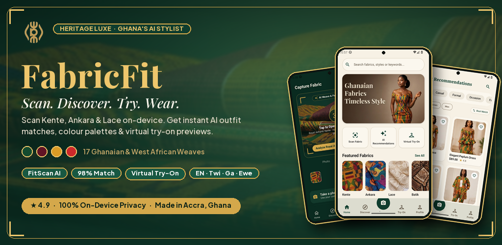
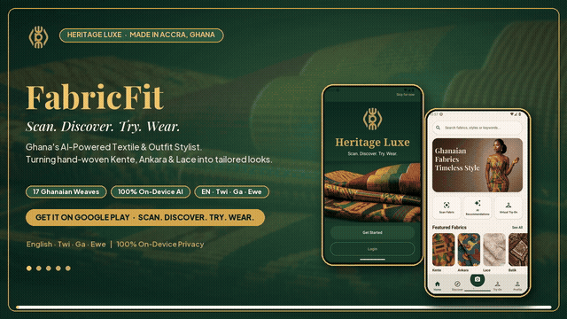
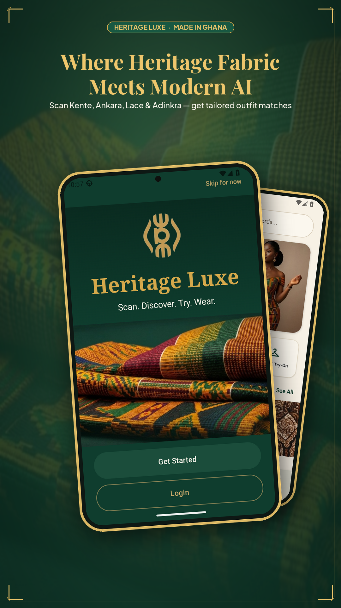
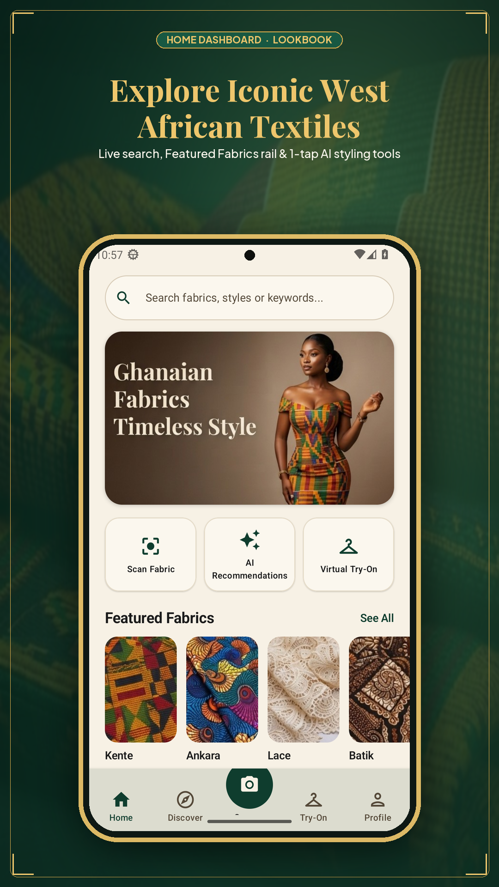
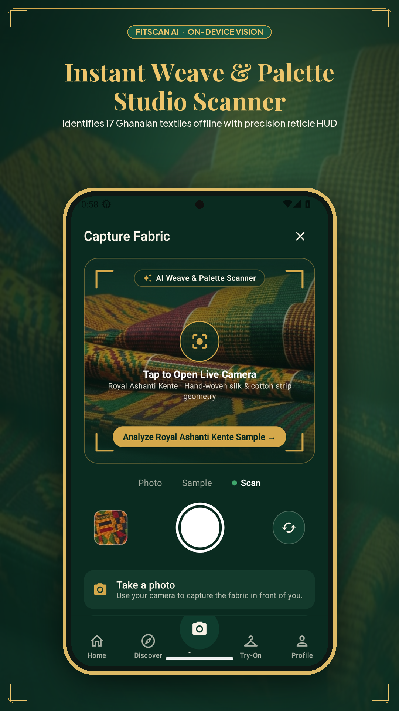
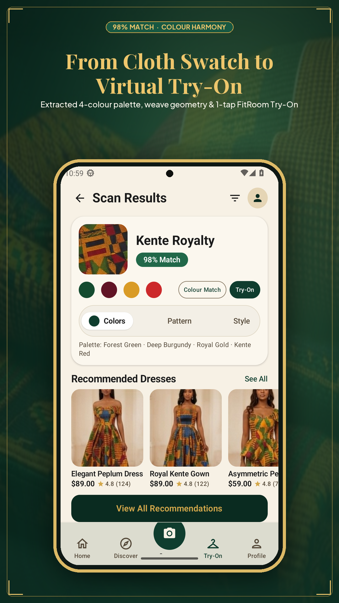
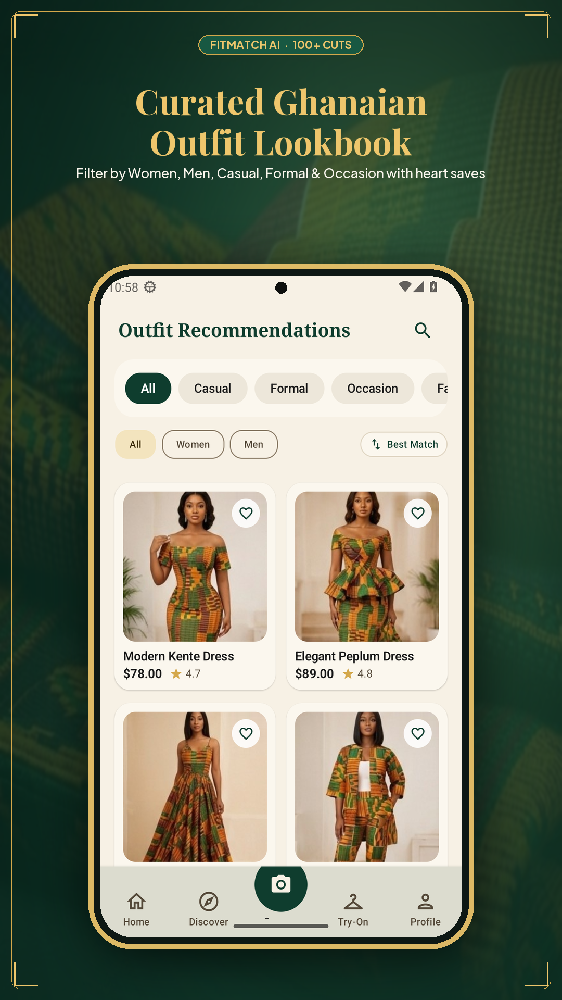
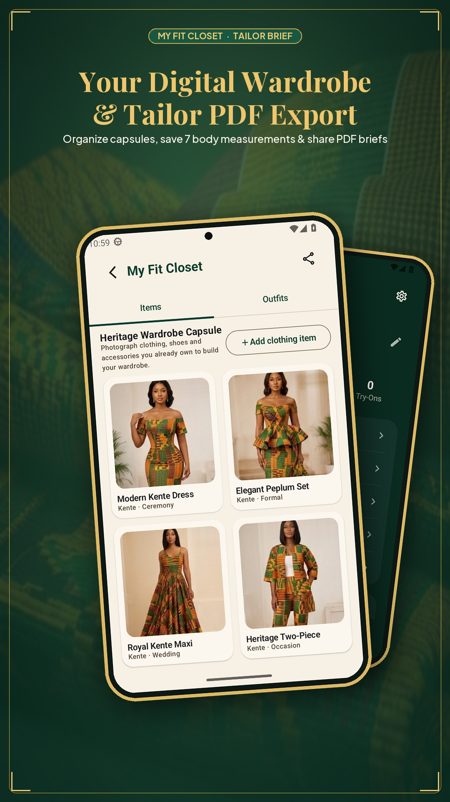

# FabricFit Marketing Materials & Google Play Store Asset Kit

<div align="center">
  
  <br>
  <sub><strong>Google Play Store Feature Graphic (`1024 × 500`) — <a href="../../store/listing.md">View Full Google Play Store Listing &amp; Asset Kit</a></strong></sub>
</div>

---

## 🎬 Google Play Store Promo Videos & Campaign Banners

<div align="center">
  
  <br>
  <sub><strong>15s Landscape Google Play Trailer (<a href="../../store/video/fabricfit_play_store_promo_16x9.mp4"><code>fabricfit_play_store_promo_16x9.mp4</code></a> · 1280×720 H.264 + AAC) &amp; 12s Vertical Play Shorts / Reels (<a href="../../store/video/fabricfit_shorts_reel_9x16.mp4"><code>fabricfit_shorts_reel_9x16.mp4</code></a> · 720×1280)</strong></sub>
</div>

### Ready-to-Publish Asset Index (`FabricFit/store/`)

| Asset | Resolution | Path |
| --- | --- | --- |
| **Google Play Hi-Res Icon** | `512 × 512` PNG | [`FabricFit/store/play_icon_512.png`](../../store/play_icon_512.png) |
| **Google Play Feature Graphic** | `1024 × 500` PNG | [`FabricFit/store/feature_graphic.png`](../../store/feature_graphic.png) |
| **Google Play Promo Video (16:9)** | `1280 × 720` MP4 (15s, Audio) | [`FabricFit/store/video/fabricfit_play_store_promo_16x9.mp4`](../../store/video/fabricfit_play_store_promo_16x9.mp4) |
| **Play Shorts / Reels Video (9:16)** | `720 × 1280` MP4 (12s, Audio) | [`FabricFit/store/video/fabricfit_shorts_reel_9x16.mp4`](../../store/video/fabricfit_shorts_reel_9x16.mp4) |
| **Promo Video Preview (GIF)** | `640 × 360` GIF | [`FabricFit/store/video/fabricfit_promo_preview.gif`](../../store/video/fabricfit_promo_preview.gif) |
| **Hero Campaign Banner (16:9)** | `1920 × 1080` PNG | [`FabricFit/store/banners/banner_wide_1920x1080.png`](../../store/banners/banner_wide_1920x1080.png) |
| **TV / Play Store Banner (16:9)** | `1280 × 720` PNG | [`FabricFit/store/banners/banner_tv_1280x720.png`](../../store/banners/banner_tv_1280x720.png) |
| **Square Launch Banner (1:1)** | `1080 × 1080` PNG | [`FabricFit/store/banners/banner_social_square_1080x1080.png`](../../store/banners/banner_social_square_1080x1080.png) |
| **Press / X Header Banner (3:1)** | `1500 × 500` PNG | [`FabricFit/store/banners/banner_x_header_1500x500.png`](../../store/banners/banner_x_header_1500x500.png) |
| **Framed Play Store Cards (×6)** | `1080 × 1920` PNG | [`FabricFit/store/screenshots/01..06_*.png`](../../store/screenshots/) |

<table>
  <tr>
    <td align="center"><br><sub>01 · Welcome</sub></td>
    <td align="center"><br><sub>02 · Home</sub></td>
    <td align="center"><br><sub>03 · FitScan AI</sub></td>
    <td align="center"><br><sub>04 · Scan Results</sub></td>
    <td align="center"><br><sub>05 · FitMatch AI</sub></td>
    <td align="center"><br><sub>06 · My Fit Closet</sub></td>
  </tr>
</table>

---

## 📱 App Store Descriptions

### Google Play Store - Short Description (80 characters)
```
Discover, design & showcase Ghanaian fashion with AI-powered virtual try-on
```

### Google Play Store - Full Description

```
🎨 DISCOVER THE BEAUTY OF GHANAIAN FASHION

FabricFit is your premium companion for exploring, designing, and showcasing authentic African fashion. From Kente to Ankara, bring Ghana's rich textile heritage to life with cutting-edge AI technology.

✨ KEY FEATURES

📷 INSTANT FABRIC RECOGNITION
Point your camera at any fabric and our AI instantly identifies:
• Fabric type (Kente, Ankara, Adinkra, Batik, and more)
• Pattern classification (Striped, Geometric, Floral, etc.)
• Color palette extraction
• Texture analysis
• Confidence scoring

🎨 VIRTUAL TRY-ON TECHNOLOGY
See how fabrics look as beautiful outfits before you buy:
• AI-powered outfit generation
• Upload your photo or use models
• Try different styles (Kaba, Slit, Gown, Shirt, etc.)
• Realistic fabric draping simulation
• Save and share your virtual looks

👗 EXPLORE 100+ DESIGN STYLES
Browse our curated collection of Ghanaian fashion:
• Traditional wedding attire
• Modern casual wear
• Formal occasion styles
• Men's and women's fashion
• Filter by occasion, gender, and fabric type

📚 BUILD YOUR DIGITAL WARDROBE
Organize all your fabrics and designs:
• Unlimited fabric scans
• Save favorite designs
• Create custom collections
• Track your style journey
• Export to PDF catalog

📤 SHARE YOUR CREATIONS
Show off your designs to the world:
• Share to Instagram, Twitter, Facebook
• Generate beautiful images with branding
• Include fabric details and hashtags
• Export wardrobe as professional PDF
• Deep links back to the app

🌍 MULTI-LANGUAGE SUPPORT
Available in 4 languages:
• English
• Twi (Akan)
• Ga
• Ewe

♿ ACCESSIBILITY FIRST
Designed for everyone:
• High contrast mode
• Reduced motion
• Large text option
• Haptic feedback controls
• Screen reader friendly

🔐 PRIVACY & SECURITY
Your data stays yours:
• Biometric app lock (fingerprint/face)
• All scans stored locally
• No data sold to third parties
• You control what gets shared
• GDPR compliant

🎯 PERFECT FOR

• Fashion designers seeking inspiration
• Tailors working with clients
• Wedding planners coordinating attire
• Fashion enthusiasts exploring styles
• Anyone who loves African fashion
• Diaspora connecting with heritage
• Students studying textile design

🌟 WHY FABRICFIT?

✅ AUTHENTIC
Celebrates genuine Ghanaian textile traditions

✅ INNOVATIVE
Cutting-edge AI meets traditional craftsmanship

✅ ACCESSIBLE
Free to use, available in local languages

✅ PRIVATE
Your data stays on your device

✅ BEAUTIFUL
Premium "Heritage Luxe" design aesthetic

📱 HOW IT WORKS

1. SCAN - Point camera at fabric
2. DISCOVER - Get instant analysis
3. DESIGN - Try on virtual outfits
4. SAVE - Build your collection
5. SHARE - Show the world

🎨 HERITAGE LUXE DESIGN

FabricFit features a premium design language inspired by Ghana's royal heritage:
• Deep Forest Green & Royal Gold palette
• Elegant serif typography (Playfair Display)
• Adinkra symbol motifs
• Smooth animations & transitions
• Professional, editorial aesthetic

🚀 WHAT'S NEW IN VERSION 1.0

• Custom branded fonts
• Biometric security
• Social media sharing
• PDF export
• Enhanced animations
• Haptic feedback
• Gesture controls
• Accessibility settings
• Performance improvements

💬 WHAT USERS SAY

"Finally, an app that understands African fabrics!" - Ama, Accra

"The virtual try-on is incredible. I can see how fabrics will look before buying." - Kwame, Kumasi

"Perfect for planning my wedding attire. The Kente recognition is spot-on!" - Esi, Cape Coast

"As a tailor, this app helps me show clients different style options instantly." - Kofi, Tamale

📧 GET IN TOUCH

Questions? Feedback? Feature requests?
• Email: support@fabricfit.app
• Website: www.fabricfit.app
• Instagram: @FabricFitApp
• Twitter: @FabricFitApp

🔒 PRIVACY POLICY

We respect your privacy. All scans are stored locally on your device. We never sell your data or share it without permission. Read our full privacy policy at www.fabricfit.app/privacy

📄 TERMS OF SERVICE

By using FabricFit, you agree to our terms of service at www.fabricfit.app/terms

---

Made with ❤️ in Ghana
Celebrating African Fashion Heritage

#GhanaianFashion #KenteCloth #AnkaraStyle #AfricanFashion #FabricFit
```

### Apple App Store Description (if expanding to iOS)

```
FabricFit - Ghanaian Fashion AI

Discover. Design. Showcase.

Your premium companion for authentic African fashion.

[Similar content as above, adapted for iOS guidelines]
```

---

## 📢 Social Media Content

### Launch Announcement - Instagram

**Image:** Beautiful mockup of app on phone with Kente fabric background

**Caption:**
```
🎉 INTRODUCING FABRICFIT! 🎉

The future of Ghanaian fashion is here! ✨

We're thrilled to launch FabricFit - your AI-powered companion for discovering, designing, and showcasing authentic African fashion.

📷 Scan any fabric → Get instant analysis
🎨 Try on virtual outfits → See how it looks
👗 Explore 100+ styles → Find your perfect match
📚 Build your wardrobe → Organize everything
📤 Share your creations → Inspire the world

From Kente to Ankara, from traditional to modern - FabricFit celebrates Ghana's rich textile heritage with cutting-edge technology.

🌍 Available in English, Twi, Ga, and Ewe
♿ Designed for accessibility
🔐 Your privacy, protected
💚 Made with love in Ghana

Download now on Google Play! Link in bio 👆

#FabricFit #GhanaianFashion #KenteCloth #AnkaraStyle #AfricanFashion #FashionTech #AI #VirtualTryOn #Ghana #MadeInGhana #AfricanDesign #FashionApp #TechLaunch
```

### Launch Tweet - Twitter/X

```
🚀 We're live! Introducing FabricFit - the AI-powered app that brings Ghanaian fashion to your fingertips.

📷 Scan fabrics instantly
🎨 Virtual try-on technology  
👗 100+ design styles
📤 Share your creations

Celebrating African heritage with cutting-edge tech. 

Download now → [link]

#FabricFit #GhanaianFashion #FashionTech #AI #MadeInGhana
```

### Facebook Post

```
🎨 BIG NEWS! 🎨

After months of development, we're proud to introduce FabricFit - a revolutionary app that combines Ghana's rich textile heritage with modern AI technology!

Whether you're a fashion designer, tailor, or simply someone who loves African fashion, FabricFit is your new best friend.

✨ What can you do?

1️⃣ SCAN FABRICS
Point your camera at any fabric and instantly learn about its type, pattern, colors, and more. Our AI recognizes Kente, Ankara, Adinkra, Batik, and many more!

2️⃣ VIRTUAL TRY-ON
Ever wondered how a fabric would look as a dress, shirt, or traditional outfit? Our AI creates realistic previews so you can see before you buy or sew!

3️⃣ EXPLORE DESIGNS
Browse our curated collection of 100+ Ghanaian fashion styles, from wedding attire to casual wear. Filter by occasion, gender, and fabric type.

4️⃣ BUILD YOUR WARDROBE
Save all your scans and designs in one place. Create collections for weddings, events, or seasons. Export everything as a beautiful PDF catalog!

5️⃣ SHARE WITH THE WORLD
Show off your creations on Instagram, Twitter, Facebook, and more. Generate beautiful images with fabric details and share instantly!

🌍 WHY WE BUILT THIS

Ghana's textile heritage is incredible - from the intricate patterns of Kente to the vibrant prints of Ankara. But finding the right fabric, visualizing it as an outfit, and organizing your collection can be challenging.

FabricFit solves these problems with technology that respects and celebrates our heritage.

💚 MADE IN GHANA, FOR THE WORLD

We're proud to be a Ghanaian tech company creating solutions that matter. FabricFit is:

✅ Free to use
✅ Available in 4 languages (English, Twi, Ga, Ewe)
✅ Accessible to everyone
✅ Private and secure
✅ Constantly improving

📱 GET THE APP

Download FabricFit now on Google Play Store! [link]

We'd love to hear from you - what features do you want to see next?

#FabricFit #GhanaianFashion #KenteCloth #AnkaraStyle #AfricanFashion #FashionTech #AI #VirtualTryOn #Ghana #MadeInGhana #TechForGood #AfricanInnovation
```

### LinkedIn Article

**Title:** Introducing FabricFit: How AI is Revolutionizing Ghanaian Fashion

```
Today marks an exciting milestone as we launch FabricFit, a mobile application that combines cutting-edge artificial intelligence with Ghana's rich textile heritage.

THE PROBLEM WE'RE SOLVING

Ghana's fashion industry is vibrant and growing, but it faces several challenges:

1. Fabric identification requires expertise
2. Visualizing fabrics as finished outfits is difficult
3. Organizing and cataloging designs is manual
4. Sharing creations lacks professional polish
5. Access to style inspiration is limited

OUR SOLUTION

FabricFit addresses these pain points with AI-powered technology:

🔹 INSTANT FABRIC RECOGNITION
Our computer vision model, trained on thousands of African textiles, can identify fabric types, patterns, colors, and textures in seconds. Simply point your camera at any fabric and receive detailed analysis.

🔹 VIRTUAL TRY-ON
Using advanced image generation, users can see how fabrics would look as different outfit styles. This "try before you buy" capability reduces waste and increases confidence in purchasing decisions.

🔹 DIGITAL WARDROBE MANAGEMENT
Users can build comprehensive digital catalogs of their fabrics and designs, organized by collections, occasions, or themes. Export functionality creates professional PDF catalogs for tailors and clients.

🔹 SOCIAL SHARING
Built-in sharing features generate branded images with fabric details, making it easy to showcase creations on social media or share privately with clients and friends.

TECHNICAL HIGHLIGHTS

FabricFit is built with modern Android technologies:

• Jetpack Compose for declarative UI
• TensorFlow Lite for on-device AI
• Material Design 3 for beautiful interfaces
• MVVM architecture for maintainability
• Offline-first design for reliability

CULTURAL IMPACT

Beyond technology, FabricFit serves a deeper purpose:

🌍 PRESERVING HERITAGE
By documenting and categorizing traditional textiles, we're creating a digital archive of Ghana's textile heritage for future generations.

🎓 EDUCATION
The app educates users about different fabric types, their origins, and appropriate uses, promoting cultural appreciation.

💼 EMPOWERING ARTISANS
Tailors and designers can showcase their work, attract clients, and streamline their workflow.

🌐 GLOBAL REACH
The diaspora can connect with their heritage and access authentic Ghanaian fashion from anywhere in the world.

WHAT'S NEXT

This launch is just the beginning. Our roadmap includes:

• AI-powered outfit recommendations
• Community features for sharing and collaboration
• E-commerce integration
• AR try-on experiences
• Expansion to other African textile traditions

JOIN US

We invite you to download FabricFit, explore its features, and share your feedback. Together, we're building the future of African fashion.

Download on Google Play: [link]

#FashionTech #AI #Ghana #AfricanFashion #Innovation #TechForGood #CulturalPreservation #MobileApps
```

---

## 📰 Press Release

**FOR IMMEDIATE RELEASE**

### FabricFit Launches AI-Powered App Celebrating Ghanaian Fashion Heritage

**ACCRA, Ghana - October 16, 2026** - FabricFit today announced the launch of its revolutionary mobile application that combines artificial intelligence with Ghana's rich textile heritage, making authentic African fashion accessible to everyone.

The free Android app allows users to instantly identify fabrics, visualize them as finished outfits, and build comprehensive digital wardrobes - all powered by cutting-edge AI technology developed in Ghana.

"Ghana's textile traditions are world-renowned, from the intricate patterns of Kente cloth to the vibrant prints of Ankara," said [Founder Name], CEO of FabricFit. "But in the digital age, we needed modern tools to celebrate, preserve, and share this heritage. FabricFit bridges tradition and technology."

#### Key Features

**Instant Fabric Recognition**
Users can point their smartphone camera at any fabric and receive instant analysis including:
- Fabric type (Kente, Ankara, Adinkra, Batik, and more)
- Pattern classification
- Color palette extraction
- Texture analysis
- Confidence scoring

**Virtual Try-On Technology**
The app's AI generates realistic previews of how fabrics would look as different outfit styles, allowing users to "try before they buy" and reducing fashion waste.

**Digital Wardrobe Management**
Users can catalog unlimited fabrics and designs, organize them into collections, and export professional PDF catalogs - perfect for tailors, designers, and fashion enthusiasts.

**Social Sharing**
Built-in sharing features generate beautiful, branded images with fabric details, making it easy to showcase creations on Instagram, Twitter, Facebook, and other platforms.

#### Accessibility and Inclusion

FabricFit is designed for everyone:
- Available in 4 languages: English, Twi, Ga, and Ewe
- Accessibility features including high contrast mode, reduced motion, and large text
- Biometric security for privacy
- Free to use with no hidden costs

#### Cultural Impact

Beyond its technical capabilities, FabricFit serves important cultural purposes:

- **Heritage Preservation**: Creates a digital archive of Ghana's textile traditions
- **Education**: Teaches users about different fabrics and their cultural significance
- **Economic Empowerment**: Helps tailors and designers showcase their work and attract clients
- **Global Connection**: Allows the diaspora to connect with their heritage from anywhere

#### Technical Innovation

Built with modern Android technologies including Jetpack Compose, TensorFlow Lite, and Material Design 3, FabricFit represents the best of Ghanaian tech innovation.

"We built FabricFit to prove that African developers can create world-class applications that solve real problems," said [CTO Name], CTO of FabricFit. "Our AI models are trained specifically on African textiles, giving us accuracy that generic solutions can't match."

#### Availability

FabricFit is available now on the Google Play Store for Android devices running Android 7.0 and above. The app is free to download and use, with all core features included at no cost.

**Download:** [Google Play Store link]  
**Website:** www.fabricfit.app  
**Social Media:** @FabricFitApp

#### About FabricFit

FabricFit is a Ghanaian technology company dedicated to celebrating and innovating in African fashion. Founded in 2026, the company combines artificial intelligence with cultural heritage to create tools that empower designers, tailors, and fashion lovers across Africa and the diaspora.

**Media Contact:**  
[Name]  
[Email]  
[Phone]  

### # #

---

## 🎬 Video Scripts

### 30-Second App Preview (for social media)

**[Scene 1: Person holding Kente fabric]**
**Voiceover:** "This is Kente. Do you know its story?"

**[Scene 2: Phone scanning fabric]**
**Voiceover:** "With FabricFit, scan any fabric..."

**[Scene 3: App showing analysis]**
**Voiceover:** "...and instantly discover its secrets."

**[Scene 4: Virtual try-on]**
**Voiceover:** "See how it looks as a beautiful outfit."

**[Scene 5: Sharing to Instagram]**
**Voiceover:** "Share your creations with the world."

**[Scene 6: App logo]**
**Voiceover:** "FabricFit. Where heritage meets innovation. Download now!"

**[Text overlay: Available on Google Play]**

---

### 2-Minute Explainer Video

**[Opening: Beautiful shots of Ghanaian fabrics and fashion]**

**Narrator:** "Ghana's textile heritage is extraordinary. From the royal Kente of the Ashanti to the vibrant Ankara prints, our fabrics tell stories of culture, identity, and artistry."

**[Cut to: Person struggling to identify fabric in market]**

**Narrator:** "But in today's world, how do we preserve this knowledge? How do we choose the right fabric, visualize it as an outfit, and share our creations?"

**[Cut to: Phone with FabricFit app opening]**

**Narrator:** "Introducing FabricFit - your AI-powered companion for Ghanaian fashion."

**[Demo: Scanning fabric]**

**Narrator:** "Simply scan any fabric, and our AI instantly identifies its type, pattern, colors, and more. Kente, Ankara, Adinkra, Batik - we know them all."

**[Demo: Virtual try-on]**

**Narrator:** "Ever wondered how a fabric would look as a dress, a shirt, or traditional attire? Our virtual try-on shows you realistic previews before you buy or sew."

**[Demo: Browsing designs]**

**Narrator:** "Explore over 100 design styles, from wedding attire to casual wear. Filter by occasion, gender, or fabric type."

**[Demo: Building wardrobe]**

**Narrator:** "Build your digital wardrobe. Save scans, organize collections, and export professional catalogs."

**[Demo: Sharing]**

**Narrator:** "Share your creations on social media with beautiful, branded images."

**[Cut to: Diverse users using app]**

**Narrator:** "Available in English, Twi, Ga, and Ewe. Designed for accessibility. Built for privacy."

**[Closing: App logo with tagline]**

**Narrator:** "FabricFit. Where heritage meets innovation. Download now on Google Play."

---

## 📊 Feature Comparison Chart

| Feature | FabricFit | Competitor A | Competitor B |
|---------|-----------|--------------|--------------|
| Fabric Recognition | ✅ AI-powered | ❌ Manual | ⚠️ Limited |
| Virtual Try-On | ✅ Advanced | ❌ None | ⚠️ Basic |
| Multi-language | ✅ 4 languages | ❌ English only | ⚠️ 2 languages |
| Offline Mode | ✅ Yes | ❌ No | ⚠️ Partial |
| Export to PDF | ✅ Yes | ❌ No | ❌ No |
| Accessibility | ✅ Full | ⚠️ Basic | ❌ None |
| Local Languages | ✅ Twi, Ga, Ewe | ❌ No | ❌ No |
| Price | ✅ Free | 💰 $4.99/mo | 💰 $2.99/mo |

---

## 🎯 Key Selling Points

### For Fashion Lovers
- Discover new styles instantly
- Try before you buy
- Build your dream wardrobe
- Share your passion

### For Tailors & Designers
- Show clients options instantly
- Create professional catalogs
- Organize your work
- Attract new customers

### For the Diaspora
- Connect with heritage
- Access authentic styles
- Share with family
- Support Ghanaian tech

### For Everyone
- Free to use
- Easy to learn
- Works offline
- Respects privacy

---

**Prepared by:** FabricFit Marketing Team  
**Date:** October 16, 2026  
**Version:** 1.0
