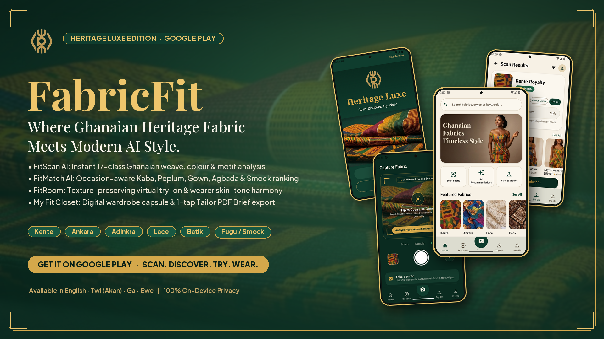
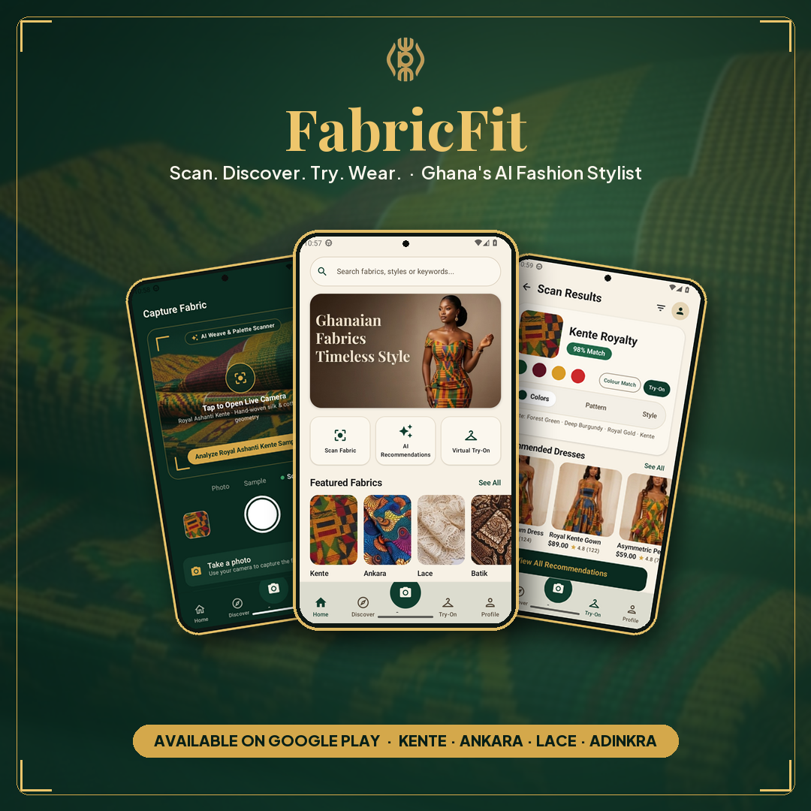
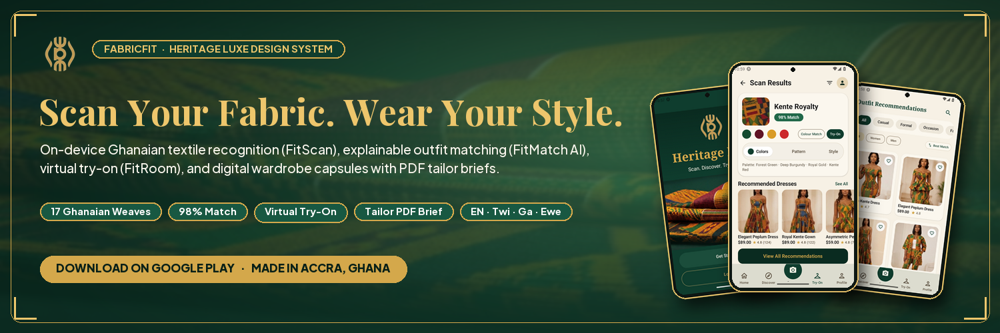
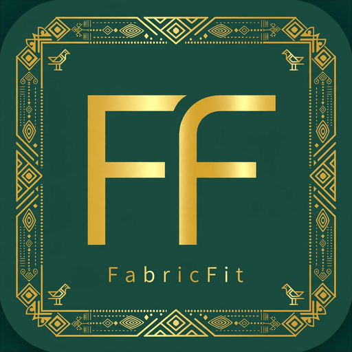

# Google Play Store Listing & Asset Kit — FabricFit (Heritage Luxe)

Complete copy-paste Play Console metadata, store graphic specifications, promotional banners, framed Play Store screenshots, and promo videos. Character counts strictly respect Google Play Console limits (**App title ≤ 30**, **Short description ≤ 80**, **Full description ≤ 4000**).

<div align="center">
  
  <br>
  <sub><strong>Google Play Feature Graphic (`1024 × 500` PNG) — `FabricFit/store/feature_graphic.png`</strong></sub>
</div>

---

## 1. Play Console Store Listing Copy

### App Title (≤ 30 characters)

```text
FabricFit: Ghanaian AI Stylist
```
*(30 characters — or `FabricFit` at 9 characters)*

### Short Description (≤ 80 characters)

```text
Scan Kente & Ankara fabric, get AI outfit matches, and try looks on virtually.
```
*(78 characters)*

#### Alternate Short Descriptions (for Google Play Store Listing Experiments / A/B Testing)

- **Variant A (68 chars):** `Scan your fabric, get AI outfit matches, and try looks on virtually.`
- **Variant B (72 chars):** `AI outfit matching for Ghanaian & African fabrics. Scan, match, try on.`
- **Variant C (75 chars):** `Scan fabric, discover styles, try on virtually — your AI stylist for Kente.`

### Full Description (≤ 4000 characters)

```text
Scan Your Fabric. Wear Your Style.

FabricFit (Heritage Luxe Edition) turns the cloth you already own into your next tailored outfit. Photograph Kente, Ankara, Wax Print, Adinkra, Lace, Batik, Brocade, or Northern Fugu/Smock weaves in your collection and FabricFit reads its weave, colour palette, and motif geometry — then shows you the styles it could become.

✨ BUILT FOR GHANAIAN & WEST AFRICAN TEXTILES (FITSCAN AI)
FitScan AI recognises 17 Ghanaian and West African fabric families on-device: Royal Ashanti & Ewe Kente, Ankara / Wax Print, Adinkra, Lace, Batik, Brocade, Tie-Dye, Fugu, Gonja, Silk, Chiffon, Velvet, Linen, Denim, and Cotton. Analysis runs 100% offline on your phone so you can scan at Makola Market, Kejetia, at home, or in your seamstress's shop with no connection required.

👗 EXPLAINABLE OUTFIT RECOMMENDATIONS (FITMATCH AI)
Every recommendation explains itself. FitMatch AI ranks 100+ designs for women and men by occasion — Wedding, Church, Office, Party, Ceremony, Festival, and Everyday — and tells you why a cut suits your cloth: how the motif scale reads, how the pattern moves, and which accent colours flatter your skin undertone. Browse Kaba & Slit, Modern Kente Dress, Elegant Peplum, Royal Gown, Two-Piece Co-ord, Agbada, Senator, and Northern Smock silhouettes.

🪞 VIRTUAL TRY-ON & COLOUR HARMONY (FITROOM)
Preview how your scanned cloth drapes on a studio model or your own photo before you spend a cedi at the tailor. Customize sleeve, neckline, hem length, and fabric placement interactively, and explore complementary, analogous, and triadic colour combinations tailored to your fabric.

🧥 DIGITAL WARDROBE & TAILOR PDF BRIEFS (MY FIT CLOSET)
Organize the fabrics and garments you own into seasonal or event capsules, record your seven body measurements on-device, and export a clean, printable PDF Design Brief (complete with fabric swatch, palette, style silhouette, customizations, and measurements) ready to share with any seamstress or tailor via WhatsApp or email.

🔒 YOUR PHOTOS STAY YOURS
• Offline-first on-device TensorFlow Lite computer vision
• No mandatory account, no ad SDK, and no data sold to third parties
• Optional biometric app lock for private measurements and lookbooks

🌍 SPEAKS GHANA'S LANGUAGES
Full interface support in English, Twi (Akan), Ga, and Ewe.

FabricFit — Where Ghanaian Heritage Fabric Meets Modern AI Style.
Made with pride in Accra, Ghana.
```

---

## 2. Google Play Graphic Assets & Promo Videos

| Asset Type | Dimensions / Spec | Path | Description |
| --- | --- | --- | --- |
| **Hi-Res App Icon** | `512 × 512` PNG | [`store/play_icon_512.png`](play_icon_512.png) | Royal Gold `FF` & Adinkra border on Deep Forest (`#0F3D2E`) |
| **Feature Graphic** | `1024 × 500` PNG | [`store/feature_graphic.png`](feature_graphic.png) | Heritage Luxe headline, weave palette dots, feature pills & 3 floating phones |
| **Play Store Promo Video (16:9)** | `1280 × 720` MP4 (H.264 + AAC, 15s) | [`store/video/fabricfit_play_store_promo_16x9.mp4`](video/fabricfit_play_store_promo_16x9.mp4) | 5-scene landscape trailer with synthesized Afro-luxury marimba score |
| **Play Shorts / Reels Video (9:16)** | `720 × 1280` MP4 (H.264 + AAC, 12s) | [`store/video/fabricfit_shorts_reel_9x16.mp4`](video/fabricfit_shorts_reel_9x16.mp4) | Vertical social & Play Shorts trailer |
| **Inline Promo Preview (GIF)** | `640 × 360` GIF | [`store/video/fabricfit_promo_preview.gif`](video/fabricfit_promo_preview.gif) | Animated preview of the 16:9 promo trailer |
| **Wide Campaign Banner** | `1920 × 1080` PNG | [`store/banners/banner_wide_1920x1080.png`](banners/banner_wide_1920x1080.png) | Full HD hero banner for web, press kits, and YouTube thumbnails |
| **TV / Tablet Banner** | `1280 × 720` PNG | [`store/banners/banner_tv_1280x720.png`](banners/banner_tv_1280x720.png) | Google Play 16:9 promotional banner |
| **Social Launch Square** | `1080 × 1080` PNG | [`store/banners/banner_social_square_1080x1080.png`](banners/banner_social_square_1080x1080.png) | Instagram / LinkedIn square launch visual |
| **X / Press Header Banner** | `1500 × 500` PNG | [`store/banners/banner_x_header_1500x500.png`](banners/banner_x_header_1500x500.png) | 3:1 social & press header banner |
| **Framed Play Store Screenshots** | `1080 × 1920` PNG (×6) | [`store/screenshots/01..06_*.png`](screenshots/) | Editorial framed 9:16 Play Console screenshots |
| **Raw Emulator Captures** | `1080 × 1920` PNG (×7) | [`docs/screenshots/*.png`](../docs/screenshots/) | Unretouched API 33 emulator captures |

---

## 3. Promo Video Preview

<div align="center">
  
  <br>
  <sub><strong>Animated Preview of `fabricfit_play_store_promo_16x9.mp4` (`1280 × 720` H.264 + AAC Audio) &amp; `fabricfit_shorts_reel_9x16.mp4` (`720 × 1280`)</strong></sub>
</div>

---

## 4. Framed Google Play Console Screenshots (`1080 × 1920`)

<table>
  <tr>
    <td align="center"><br><strong>01 · Welcome &amp; Brand</strong></td>
    <td align="center"><br><strong>02 · Home Lookbook</strong></td>
    <td align="center"><br><strong>03 · FitScan AI Studio</strong></td>
  </tr>
  <tr>
    <td align="center"><br><strong>04 · Scan Results &amp; Try-On</strong></td>
    <td align="center"><br><strong>05 · FitMatch AI Lookbook</strong></td>
    <td align="center"><br><strong>06 · My Fit Closet &amp; PDF</strong></td>
  </tr>
</table>

---

## 5. Promotional & Social Campaign Banners

<div align="center">
  
  <br>
  <sub><strong>16:9 Full HD Campaign Banner (`1920 × 1080`) — `FabricFit/store/banners/banner_wide_1920x1080.png`</strong></sub>
</div>

<br>

<table>
  <tr>
    <td align="center" width="40%"><br><sub><strong>1:1 Square Social Launch (`1080 × 1080`)</strong></sub></td>
    <td align="center" width="60%"><br><sub><strong>3:1 Press &amp; Social Header (`1500 × 500`)</strong></sub><br><br><br><sub><strong>Hi-Res Play Store Icon (`512 × 512`)</strong></sub></td>
  </tr>
</table>

---

## 6. Play Console Categorisation & Compliance

- **Application Type:** App
- **Category:** **Lifestyle** (Secondary / Store Listing tag: **Fashion & Beauty**, **Design & Art**, **Shopping**)
- **Content Rating:** Everyone (IARC — no violence, gambling, or unrestricted user-generated content)
- **Privacy Policy:** [`store/privacy_policy.html`](privacy_policy.html) & Data Safety declarations in [`docs/PLAY_DATA_SAFETY.md`](../docs/PLAY_DATA_SAFETY.md)
- **Supported Locales:** `en-US` / `en-GH` (English), `tw` (Twi / Akan), `gaa` (Ga), `ee` (Ewe)
