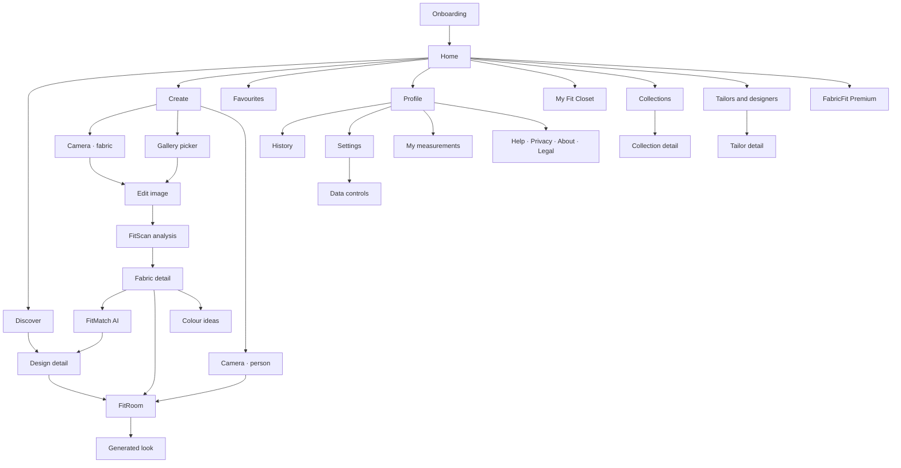

# FabricFit — Heritage Luxe

[](https://github.com/Jacinth-19/fabricfit-app/actions/workflows/build.yml)

<div align="center">

**Scan. Discover. Try. Wear.**

*Where Ghanaian Heritage Fabric Meets Modern Style.*

<p align="center">
  
</p>

</div>

## About

FabricFit (internally codenamed **Heritage Luxe**) is a premium Android experience built in
Kotlin + Jetpack Compose that honours the rich textile heritage of Ghana — Kente, Ankara,
wax print, lace, batik and more. Point your camera at a cloth and FitScan AI identifies the
weave, palette and pattern; FitMatch AI recommends tailored outfits; FitRoom lets you try
them on virtually; and My Fit Closet keeps your entire wardrobe at your fingertips so you
can walk into your tailor with a shareable, professional brief.

> The project was formerly known as **Ntoma Studio** (`com.ntoma.studio`). It has been
> renamed to **FabricFit** (`com.fabricfit.app`). See
> [`FabricFit/docs/brand_positioning.md`](FabricFit/docs/brand_positioning.md) for brand
> guidance and naming notes.

---

## Heritage Luxe Design System

The new UI embraces a **premium cultural aesthetic** that feels both rooted in Ghanaian
craft and world-class luxury fashion.

| Token | Value | Usage |
| --- | --- | --- |
| **Primary — Deep Forest** | `#0F3D2E` | Splash, profile, primary CTAs, selected nav states, camera chrome |
| **Accent — Royal Gold** | `#D4A84B` | Wordmark, high-emphasis buttons, rating stars, premium highlights |
| **Surface — Warm Cream** | `#F7F1E5` | App background, cards, sheets, light surfaces |
| **Text — Ink** | `#1A1A1A` | Headlines, body copy on light surfaces |
| **Text — Cream** | `#F7F1E5` | Body copy on dark surfaces |
| **Text — Muted Gold** | `#C8A96A` | Secondary text on dark surfaces, outlined button labels |

Typography pairs an elegant display serif for headlines (Heritage Luxe wordmark, section
titles) with a clean modern sans-serif for body and UI controls, evoking the balance of
royal tradition and contemporary fashion.

### Brand mark

The launch icon and splash glyph is a custom **adinkra-inspired monogram** — symmetrical,
woven, and rooted in Akan visual language — rendered in Royal Gold against Deep Forest.

---

## Feature Suite

| Feature | In-app name | What it does |
| --- | --- | --- |
| Camera scanner | **FitScan** | Photograph any fabric; on-device ML classifies the textile and extracts its palette, pattern and texture. |
| AI recommendation engine | **FitMatch AI** | Ranks outfit designs against your fabric with a confidence % and a plain-language reason; filterable by occasion. |
| Virtual try-on | **FitRoom** | Drapes the scanned fabric onto a model (or your own photo) so you can see the finished look before you sew. |
| Wardrobe & saved items | **My Fit Closet** | Save every scan, favourite, generated look and measurement in one place. |

---

## Screens — Heritage Luxe UI

These six screens define the refreshed visual direction. High-fidelity mockups live in
[`FabricFit/docs/heritage-luxe-mockups/`](FabricFit/docs/heritage-luxe-mockups/). For the
current state of the shipping Android app, see the [Real App UI](#real-app-ui) section
below.

### 1. Welcome / Splash

<p align="left">
  
</p>

- Deep Forest full-bleed background
- Gold adinkra monogram above the **Heritage Luxe** wordmark
- Tagline: *Scan. Discover. Try. Wear.*
- Stacked, photorealistic folds of Kente and Ankara anchor the lower half
- Two CTAs: filled **Get Started** (primary) and outlined **Login** (secondary)

### 2. Home Dashboard

<p align="left">
  
</p>

- Warm Cream surface with generous whitespace
- Rounded search bar: *"Search fabrics, styles or keywords…"*
- Editorial hero banner — *"Ghanaian Fabrics · Timeless Style"* — featuring a Kente
  off-shoulder gown
- Three equal quick-action cards: **Scan Fabric**, **AI Recommendations**, **Virtual
  Try-On**, each with a line icon
- **Featured Fabrics** horizontal rail: Kente · Ankara · Lace · Batik, with "See All"
- Bottom navigation: **Home** · **Discover** · *central camera FAB (Deep Forest circle)* · **Try-On** · **Profile**

### 3. Capture Fabric (FitScan)

<p align="left">
  
</p>

- Full-bleed camera viewfinder with a close-up fabric preview (Kente shown)
- Dark chrome header: *"Capture Fabric"* + close affordance
- Mode switcher: **Photo** · **Video** · **Scan** (active pill in Deep Forest with dot indicator)
- Shutter row: gallery thumbnail (last capture) · circular shutter · flip-camera affordance

### 4. Scan Results

<p align="left">
  
</p>

- Return arrow, *"Scan Results"* title, profile avatar
- Result card: fabric swatch thumbnail + fabric name (**Kente Royalty**) + confidence pill (**98% Match** in Deep Forest)
- Extracted colour palette as circular swatches (forest green, burgundy, gold, red)
- Segmented tabs: **Colors** · Pattern · Style
- **Recommended Dresses** horizontal carousel with favourite (♡) toggle, price, rating and review count
- Wide gold-on-forest CTA: **View All Recommendations**
- Bottom nav on this surface swaps the Try-On tab for a **cart** entry, reflecting commerce intent

### 5. Outfit Recommendations (FitMatch AI)

<p align="left">
  
</p>

- Section title: **Outfit Recommendations**
- Filter chips: **All** (selected, Deep Forest) · Casual · Formal · Occasion
- Two-column card grid showing each styled look with heart favourite affordance
- Each card carries the style name, price and gold-star rating (4.6–4.9)
- Example looks: *Modern Kente Dress*, *Elegant Peplum Dress*, *Maxi Dress*, *Two-Piece Set*
- Bottom nav: Home · Discover · Camera · **Saved** (bookmark) · Profile

### 6. Profile

<p align="left">
  
</p>

- Deep Forest surface for a premium, intimate feel; settings gear in the header
- Circular user avatar + name (e.g. **Ama Serwaa**) + role (*Fashion Lover*)
- Stats row: **12** Scans · **8** Favorites · **3** Try-Ons
- Navigation list in translucent cards: **My Wardrobe** · **Saved Styles** · **Scan History** · **Settings** · **Help & Support**, each with a glyph and chevron
- Bottom nav matches the Home tab set, with Profile active

---

## Repository layout

```
FabricFit/          Android app (Kotlin + Jetpack Compose), package com.fabricfit.app
  app/              app module — UI, domain, data, on-device ML
  docs/             brand positioning, Play readiness, device QA, research notes,
                    heritage-luxe-mockups/ (design references)
  store/            Play listing copy, icon and feature graphic, privacy policy
  tools/            i18n packs, dataset pipeline, mock backend, icon renderer
tools/              sandbox toolchain bootstrap
```

## Build

```bash
bash tools/setup_toolchain.sh
cd FabricFit
./gradlew :app:assembleDebug
```

Full instructions, verified status and release signing: [`FabricFit/BUILD.md`](FabricFit/BUILD.md).

## Languages

English, Twi (`tw`), Ga (`gaa`) and Ewe (`ee`). Translation packs live in
`FabricFit/tools/i18n/`; regenerate with `python3 tools/i18n/generate.py` from the
`FabricFit` directory.

---

## Navigation map (29 screens)

The app ships **29 screens**: 28 registered in the navigation graph plus the first-run
onboarding gate. Routes are declared in
[`ui/navigation/Destinations.kt`](FabricFit/app/src/main/java/com/fabricfit/app/ui/navigation/Destinations.kt)
and wired up in
[`ui/navigation/FabricFitNavHost.kt`](FabricFit/app/src/main/java/com/fabricfit/app/ui/navigation/FabricFitNavHost.kt).



### Core tabs (bottom navigation)

| Screen | Route | What it does |
| --- | --- | --- |
| Home | `home` | Greeting, quick-scan actions, recent scans and favourites, feature tools row |
| Discover | `discover` | Browse the entire catalogue; smart search by free-text keywords |
| Create | `create` | Capture hub — camera, gallery, or apply a design to a person |
| Favourites | `favorites` | Five tabs: Fabrics, Designs, Looks, Collections, Tailors |
| Profile | `profile` | Stats, history, preferences, measurements, premium and support |

### Scan & analyse — **FitScan**

| Screen | Route | What it does |
| --- | --- | --- |
| Onboarding | first-run gate | Four-step intro (scan → discover → try on → save) shown by `AppShell` while `onboardingCompleted` is false; ends at "Scan my fabric". Replayable from Settings. |
| Camera | `camera/fabric`, `camera/person` | CameraX capture; the person variant feeds FitRoom. Permission requested only on tap. |
| Edit image | `edit/{uri}/{target}` | Crop and straighten before analysis. |
| FitScan analysis | `analysis/{uri}` | Palette, pattern, texture, suggested fabric, and which engine ran (on-device or cloud). |
| Fabric detail | `fabric/{id}` | A saved fabric with its palette, style matches and the jump-off to matching, try-on and colour ideas. |

### Discovery & matching — **FitMatch AI**

| Screen | Route | What it does |
| --- | --- | --- |
| FitMatch AI | `recommendations/{fabricId}` | Ranked designs with confidence % and plain-language reasoning; filter by gender and occasion. |
| Design detail | `design/{styleId}` | Full design view: suitable fabrics, occasions, pick-a-fabric, favourite, share, save to collection, request a tailor quote, try on. |
| Colour ideas | `colormatch/{fabricId}` | Complementary, analogous, neutral and metallic pairings for shoes, bags, jewellery and headwraps. |

### Visualisation — **FitRoom**

| Screen | Route | What it does |
| --- | --- | --- |
| FitRoom | `tryon?fabricId=&styleId=&person=` | Pick wearer, add a photo, choose a design, apply the fabric. Shows progress and free-tier quota. |
| Generated look | `result/{lookId}` | Finished look with before/after compare slider, favourite, share, save to gallery, add to collection, generate variations, or start over. Carries AI and demo-engine disclaimers. |

### Closet, collections & tailoring

| Screen | Route | What it does |
| --- | --- | --- |
| My Fit Closet | `wardrobe` | Photograph clothing, shoes and accessories you own; tabs for Items and Outfits, plus "Build an outfit" / "Surprise me". |
| Collections | `collections` | Group fabrics and designs into your own collections. |
| Collection detail | `collection/{id}` | Everything saved into one collection. |
| Tailors & designers | `tailors` | Demo directory of tailors and designers. |
| Tailor detail | `tailor/{id}?styleId&fabricId` | A tailor's profile plus the shareable design brief ("request a quote") for a given design and fabric. |
| My measurements | `measurements` | Seven fields — height, chest, waist, hip, shoulder, sleeve, inseam — stored only on device, with a disclaimer that the app never estimates measurements. |

### Account, info & legal

| Screen | Route | What it does |
| --- | --- | --- |
| History | `history` | Every scan, chosen design and generated look, with one-tap clear. |
| Settings | `settings` | Analysis provider (on-device vs cloud), cloud URL, notifications, appearance, language, data saver, personalization reset, about. |
| Data controls | `settings/data` | Delete my data, and export your contributions as a zip. |
| Help & tips | `settings/help` | How it works, FAQs by category, and a support contact that prefills your app version. |
| Privacy | `settings/privacy` | Short version first, then what stays on device, what would be uploaded and why, retention and permissions. |
| About | `settings/about` | Logo, tagline, version, **"Made in Accra, Ghana"** and credits. |
| Legal | `legal/{doc}` | Terms, privacy policy and credits documents. |
| FabricFit Premium | `premium` | Free-tier limits, premium benefits and the paywall sheet (demo billing manager, labelled as such). |

---

## Real app UI (current build)

These are **unretouched screenshots of the running FabricFit Android app**, captured by
GitHub Actions on an API 33 Pixel 2 emulator at 1080 × 1920. These reflect the current
shipped Compose UI and will be re-skinned to match the **Heritage Luxe** design system
above in an upcoming release.

<table>
  <tr>
    <td align="center"><br><strong>Home</strong></td>
    <td align="center"><br><strong>Discover</strong></td>
    <td align="center"><br><strong>Create</strong></td>
  </tr>
  <tr>
    <td align="center"><br><strong>Favourites</strong></td>
    <td align="center"><br><strong>Profile</strong></td>
    <td align="center"><br><strong>My Fit Closet</strong></td>
  </tr>
</table>

To refresh these captures, run the `build.yml` workflow via **Actions → build → Run
workflow**. Its `screenshots` job rebuilds the debug app, boots an API 33 Pixel 2
emulator, captures all six screens with
[`tools/qa/capture_with_retry.sh`](tools/qa/capture_with_retry.sh) (three attempts with
backoff), and commits the refreshed PNGs back to the branch.

### Play Store screenshots

These README captures are **not** Play Store listing creatives. Play requires at least
two phone screenshots (16:9 or 9:16, 320–3840 px). The feature-focused shot list in
[`docs/PLAY_DATA_SAFETY.md`](FabricFit/docs/PLAY_DATA_SAFETY.md) is:

**Welcome → Home → FitScan (capture) → FitMatch AI (recommendations) → FitRoom (try-on) → My Fit Closet**

Generated Play creatives should follow the Heritage Luxe design tokens above and be saved
under `FabricFit/store/screenshots/`.

---

## Taglines

| Use | Line |
| --- | --- |
| **Primary (shipped)** | Scan Your Fabric. Wear Your Style. |
| Luxe / fashion (Heritage Luxe) | Where Heritage Fabric Meets Modern Fit. |
| Tech-focused | AI-Powered Ghanaian Fabric & Outfit Matching. |
| Welcome screen | Scan. Discover. Try. Wear. |

Made in **Accra, Ghana** 🇬🇭
