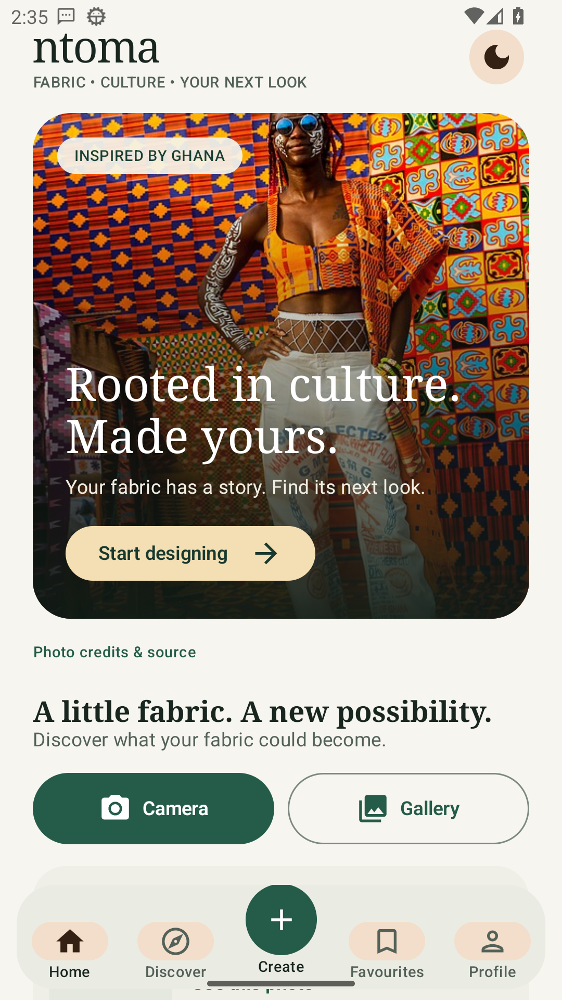
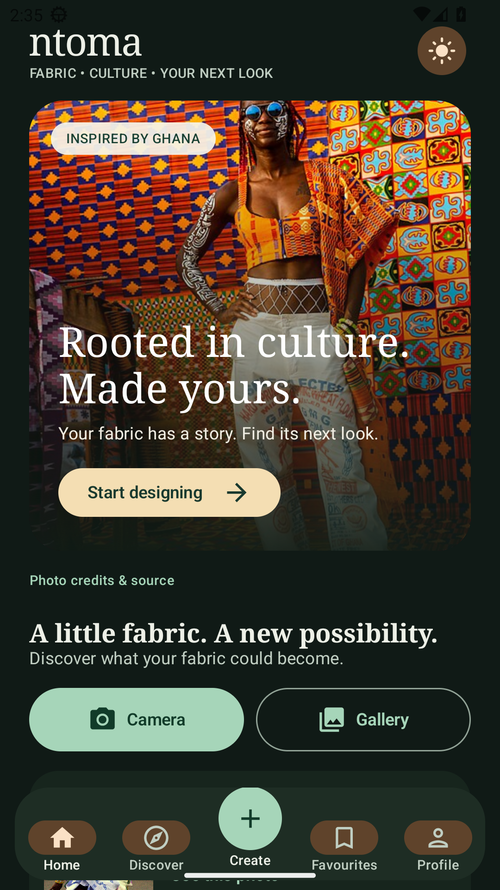
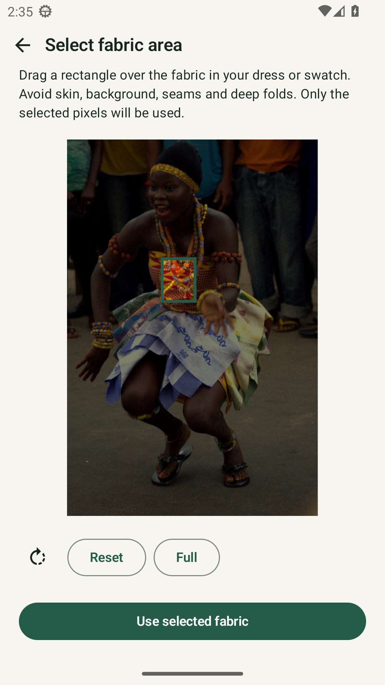
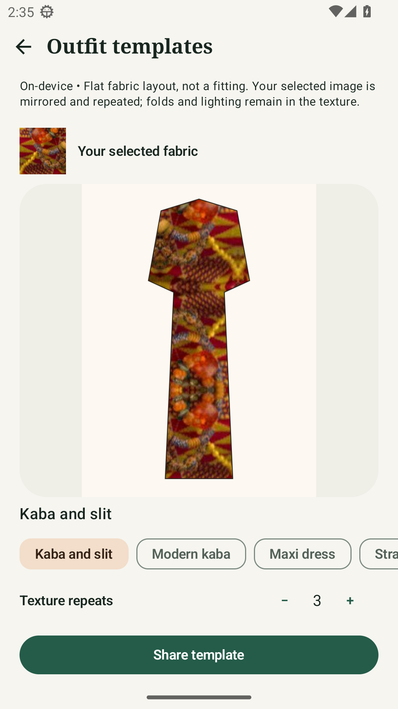

# Ntoma Studio

**Rooted in culture. Made yours.**

Explore what your fabric could become. Ntoma Studio is an Android app that helps you select fabric from a photo, discover its colours and patterns, and preview it in different outfit layouts—inspired by Ghanaian dress traditions.

[Download the current test APK](https://github.com/Jacinth-19/ntoma-studio/releases/download/debug-latest/app-debug.apk) · [Release notes](https://github.com/Jacinth-19/ntoma-studio/releases/tag/debug-latest) · [Build instructions](NtomaStudio/BUILD.md)

> **Which version am I seeing?** The screenshots below show the new design on this branch. The downloadable APK still has the previous design: the new build passed Android 33 testing, but its Android 16 emulator setup failed before testing. The download will update only after both device checks pass.

## One studio. Two moods.

Warm ivory by day. Deep forest green by night. Tap the **sun/moon button** on Home, Create or Discover to switch themes; your choice is saved. Prefer to follow your phone? Choose **System** in Settings → Theme.

<table>
  <tr>
    <td align="center"><strong>Light mode · Warm ivory</strong></td>
    <td align="center"><strong>Dark mode · Forest green</strong></td>
  </tr>
  <tr>
    <td align="center"></td>
    <td align="center"></td>
  </tr>
</table>

Real photography, not generated people: the Home image shows Kente fashion at Afrochella in Ghana, photographed by **Fquasie**. The app also includes an **Adowa dancer in Kente**, photographed by **Bright Kwame Ayisi (Kwameghana)**, as an offline sample you can explore.

Both photographs are used under **CC BY-SA 4.0**, with credits and original-source links in the app. The people pictured are not presented as endorsers. [Photo sources and licences →](NtomaStudio/app/src/main/assets/editorial/CREDITS.md)

## From a photo to an outfit idea

1. **Choose your starting point.** Take a photo, select one from your gallery, or try the bundled Adowa photo. You can use a fabric swatch or fabric in an existing dress.
2. **Select the fabric.** Drag a rectangle over a clear patch of cloth. Only the selected pixels are used.
3. **Explore the details.** See dominant colours, pattern observations and an estimated fabric category.
4. **Make it your own.** Try different garment templates, adjust the texture repeats, and share a layout with a tailor or friend.

<table>
  <tr>
    <td align="center"><strong>Select fabric from a real photo</strong></td>
    <td align="center"><strong>Explore a new silhouette</strong></td>
  </tr>
  <tr>
    <td align="center"></td>
    <td align="center"></td>
  </tr>
</table>

*All screenshots above are captures of the installed Android app, not UI mockups. [Capture details and image credits](docs/images/README.md).*

**Tip:** Pick an evenly lit area without skin, background, seams or deep folds. The app keeps the lighting and folds in the pixels you select.

## Try it on your phone

The available download is an **English-language debug test build** for **Android 7.0 or newer**, not a Google Play release.

1. Open the [APK download](https://github.com/Jacinth-19/ntoma-studio/releases/download/debug-latest/app-debug.apk) on your Android phone.
2. Open the downloaded file and allow installation from that source if Android asks.
3. Launch Ntoma Studio and choose a fabric photo.

The test app uses package `com.ntoma.studio.debug`, separate from a future production version. See the version note above before downloading if you want the new design specifically.

## What the previews mean

Outfit templates are **flat design ideas**, not fit predictions or photorealistic try-on. Fabric identification is an estimate, not a verified material assessment. Cloud photoreal try-on is not available yet.

By default, analysis and template previews run **on your phone without uploading your photos**. An optional cloud-analysis endpoint receives the selected image only if you explicitly configure and select it. Sharing a template is your choice.

English is the current launch language. Twi, Ga and Ewe are planned after native-language review; those drafts are not shipped in the app.

## Build and contribute

The Android project is in [`NtomaStudio/`](NtomaStudio/): **Kotlin · Jetpack Compose · LiteRT · target API 36**.

With JDK 17 and Android SDK 36 installed:

```sh
cd NtomaStudio
bash gradlew :app:assembleDebug :app:testDebugUnitTest
```

GitHub Actions checks the build, unit tests, native-library alignment and the installed fabric workflow on Android 33 and Android 16 with 16 KB memory pages. The debug prerelease is refreshed only after the build and both device journeys pass.

- [Redesign implementation and test status](NtomaStudio/docs/EDITORIAL_REDESIGN.md)
- [Build instructions](NtomaStudio/BUILD.md)
- [Workflow validation history](NtomaStudio/docs/VALIDATED_FABRIC_WORKFLOW.md)
- [Production signing and Play release setup](NtomaStudio/docs/PRODUCTION_RELEASE.md)
- [Privacy policy](NtomaStudio/store/privacy_policy.html) · [Data safety notes](NtomaStudio/docs/PLAY_DATA_SAFETY.md)

Found a problem or have an idea? [Open an issue](https://github.com/Jacinth-19/ntoma-studio/issues).
