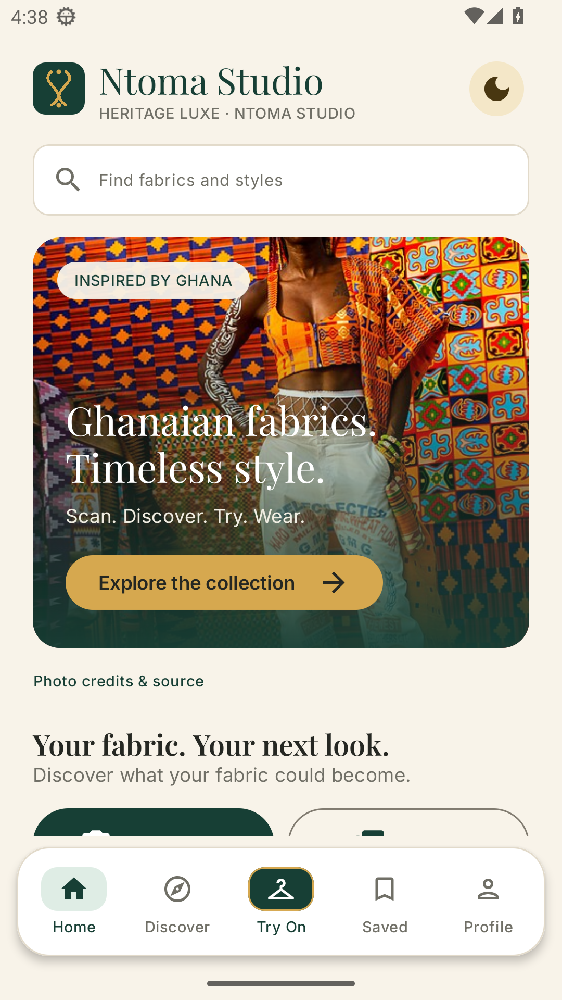
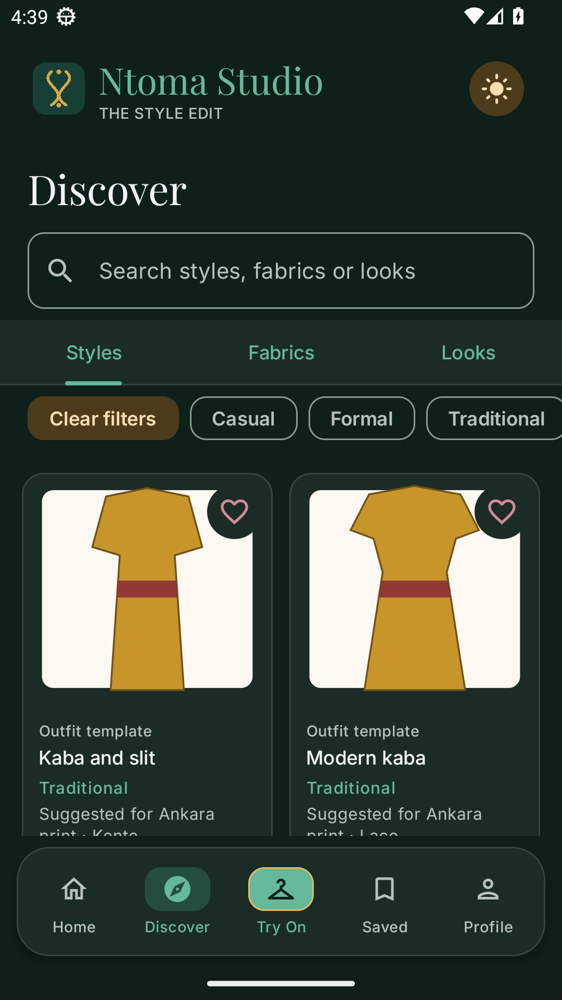
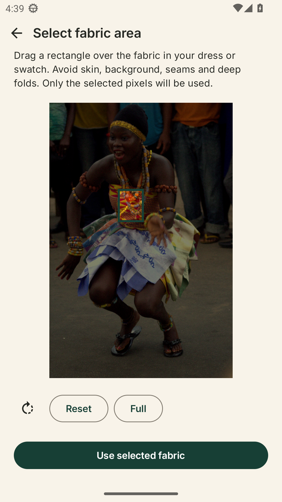
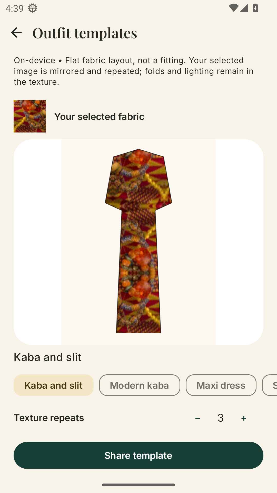

# Ntoma Studio

**Rooted in culture. Made yours.**

Explore what your fabric could become. Ntoma Studio is an Android app that helps you select fabric from a photo, discover its colours and patterns, and preview it in different outfit layouts—inspired by Ghanaian dress traditions.

[Download the current test APK](https://github.com/Jacinth-19/ntoma-studio/releases/download/debug-latest/app-debug.apk) · [Release notes](https://github.com/Jacinth-19/ntoma-studio/releases/tag/debug-latest) · [Build instructions](NtomaStudio/BUILD.md)

> **Which version am I seeing?** The screenshots below come from the **Heritage Luxe** build on this branch (commit `111856b`), captured from the installed app on **Android 33**. The downloadable APK is still the **previous** test build and will not change until a new build passes both device checks. On the Heritage Luxe build, the **Android 16 (API 36)** journey failed: the app process crashed during its first test. The Android 33 pass is the only device evidence so far.

## Heritage Luxe: warm ivory by day, forest green by night

Warm ivory and deep forest green, with gold and burgundy accents, elegant serif headings and Inter for everything you read and tap. Tap the **sun/moon button** on Home, Try On or Discover to switch themes; your choice is saved. Prefer to follow your phone? Choose **System default** in Settings → Theme.

<table>
  <tr>
    <td align="center"><strong>Light mode · Warm ivory</strong></td>
    <td align="center"><strong>Dark mode · Forest green</strong></td>
  </tr>
  <tr>
    <td align="center"></td>
    <td align="center"></td>
  </tr>
</table>

Five destinations sit in one floating bar: **Home, Discover, Try On, Saved and Profile**. Try On is the centre tab and is highlighted in forest green with a gold outline.

Real photography, not generated people: the Home image shows Kente fashion at Afrochella in Ghana, photographed by **Fquasie**. The fabric-selection sample is an **Adowa dancer in Kente**, photographed by **Bright Kwame Ayisi (Kwameghana)**.

Both photographs are used under **CC BY-SA 4.0**, with credits and original-source links in the app. The people pictured are not presented as endorsers. [Photo sources and licences →](NtomaStudio/app/src/main/assets/editorial/CREDITS.md)

## From a photo to an outfit idea

1. **Choose your starting point.** Take a photo, select one from your gallery, or try the bundled Adowa photo. You can use a fabric swatch or fabric in an existing dress.
2. **Select the fabric.** Drag a rectangle over a clear patch of cloth. Only the selected pixels are used.
3. **Explore the details.** See dominant colours, pattern observations and an estimated fabric category.
4. **Make it your own.** Try different garment templates, adjust the texture repeats, and share a layout with a tailor or friend.

<table>
  <tr>
    <td align="center"><strong>Select fabric from a real photo</strong></td>
    <td align="center"><strong>Preview on an outfit template</strong></td>
  </tr>
  <tr>
    <td align="center"></td>
    <td align="center"></td>
  </tr>
</table>

*All screenshots above are unedited captures of the installed Android app, not UI mockups. The outfit template is a flat layout, not a fitting. [Capture details and image credits](docs/images/README.md).*

**Tip:** Pick an evenly lit area without skin, background, seams or deep folds. The app keeps the lighting and folds in the pixels you select.

## Try it on your phone

The available download is an **English-language debug test build** for **Android 7.0 or newer**, not a Google Play release.

1. Open the [APK download](https://github.com/Jacinth-19/ntoma-studio/releases/download/debug-latest/app-debug.apk) on your Android phone.
2. Open the downloaded file and allow installation from that source if Android asks.
3. Launch Ntoma Studio and choose a fabric photo.

The test app uses package `com.ntoma.studio.debug`, separate from a future production version. See the version note above: the download is the previous design until a new build passes both device checks.

## What the previews mean

Outfit templates are **flat design ideas**, not fit predictions or photorealistic try-on. Fabric identification is an estimate, not a verified material assessment. Cloud photoreal try-on is planned for later and is not available in this build.

By default, analysis and template previews run **on your phone without uploading your photos**. An optional cloud-analysis endpoint receives the selected image only if you explicitly configure and select it. Sharing a template is your choice.

English is the current launch language. Twi, Ga and Ewe are planned after native-language review; those drafts are not shipped in the app.

## Build and contribute

The Android project is in [`NtomaStudio/`](NtomaStudio/): **Kotlin · Jetpack Compose · LiteRT · compile and target API 36, minimum API 24**.

With JDK 17 and Android SDK 36 installed:

```sh
cd NtomaStudio
bash gradlew :app:assembleDebug :app:testDebugUnitTest
```

GitHub Actions builds the app, runs the unit tests, checks native-library alignment, then runs the installed-app fabric journey on **Android 33** and **Android 16 with 16 KB memory pages**. The debug prerelease is refreshed only after the build and both device journeys pass.

- [Heritage Luxe design implementation and verification](NtomaStudio/docs/HERITAGE_LUXE.md)
- [Capture details and photo credits](docs/images/README.md)
- [Build instructions](NtomaStudio/BUILD.md)
- [Workflow validation history](NtomaStudio/docs/VALIDATED_FABRIC_WORKFLOW.md)
- [Production signing and Play release setup](NtomaStudio/docs/PRODUCTION_RELEASE.md)
- [Privacy policy](NtomaStudio/store/privacy_policy.html) · [Data safety notes](NtomaStudio/docs/PLAY_DATA_SAFETY.md)

Found a problem or have an idea? [Open an issue](https://github.com/Jacinth-19/ntoma-studio/issues).
