# FabricFit — Heritage Luxe

[](https://github.com/Jacinth-19/fabricfit-app/actions/workflows/build.yml)
[](https://github.com/Jacinth-19/fabricfit-app/releases/latest)
[](https://github.com/Jacinth-19/fabricfit-app/releases/latest/download/fabricfit-v1.0.2.apk)

<div align="center">

### **Scan. Discover. Try. Wear.**
*Where Ghanaian Heritage Fabric Meets Modern Style.*

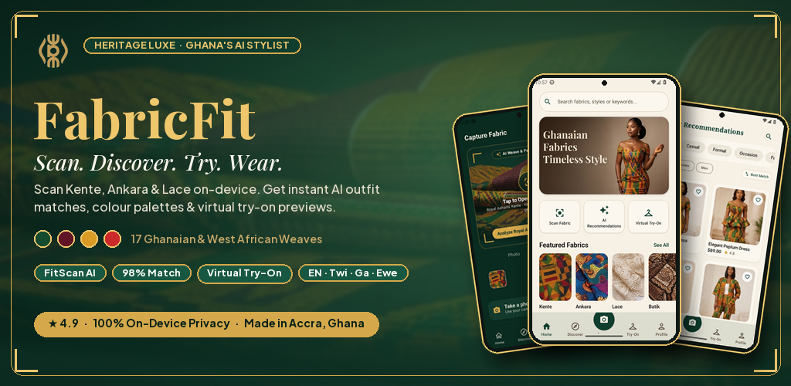

<br><br>

<table>
  <tr>
    <td align="center">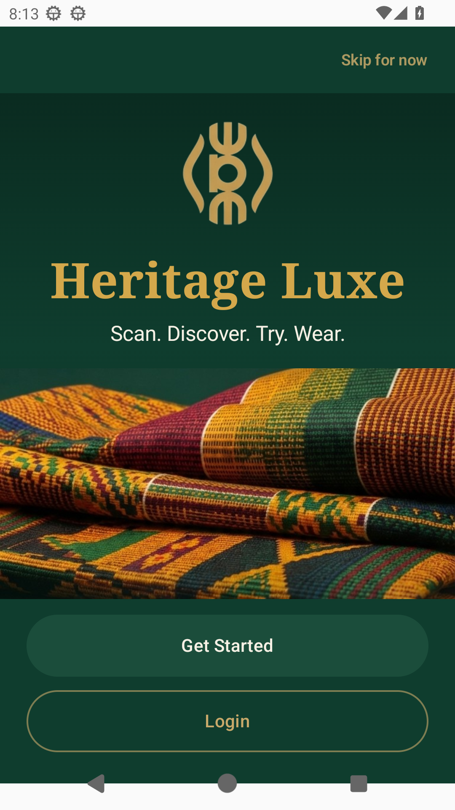<br><sub><strong>Welcome · Heritage Luxe</strong></sub></td>
    <td align="center">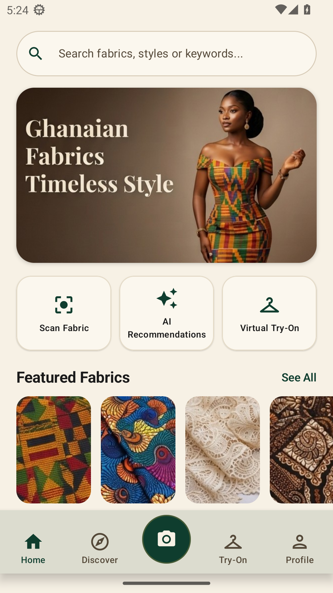<br><sub><strong>Home Dashboard</strong></sub></td>
    <td align="center">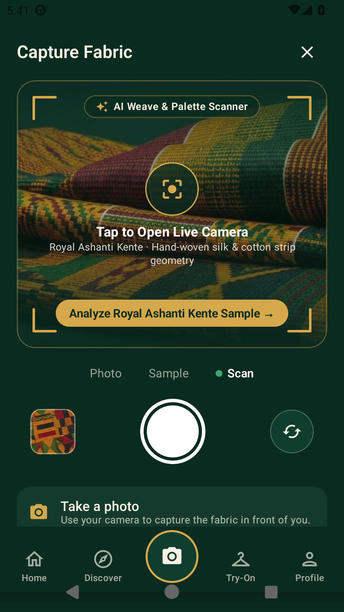<br><sub><strong>FitScan · Capture Fabric</strong></sub></td>
    <td align="center">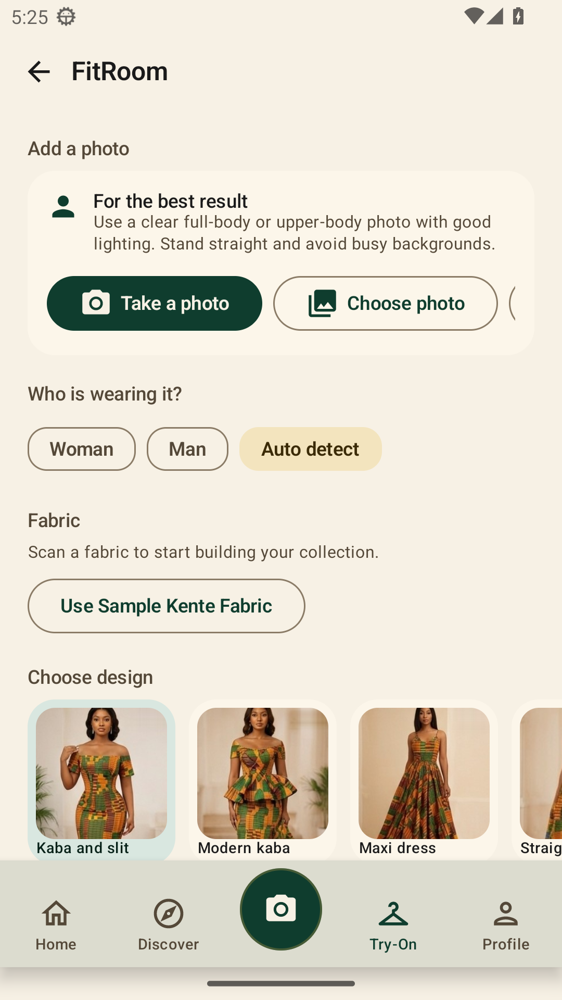<br><sub><strong>FitRoom · Virtual Try-On</strong></sub></td>
  </tr>
</table>

</div>

---

## Google Play Store Marketing Kit, Promo Videos & Banners

Complete Google Play Console store listing copy, feature graphics, framed screenshot cards, social/campaign banners, and promo videos live in [`FabricFit/store/`](FabricFit/store/listing.md) and [`FabricFit/docs/marketing/MARKETING_MATERIALS.md`](FabricFit/docs/marketing/MARKETING_MATERIALS.md):

<div align="center">
  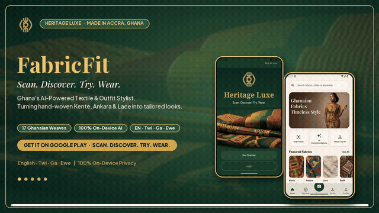
  <br>
  <sub><strong>🎬 <a href="FabricFit/store/video/fabricfit_play_store_promo_16x9.mp4">16:9 Google Play Promo Video (MP4 + Audio)</a> · <a href="FabricFit/store/video/fabricfit_shorts_reel_9x16.mp4">9:16 Play Shorts / Reels Video (MP4 + Audio)</a> · <a href="FabricFit/store/listing.md">Full Play Store Listing Kit</a></strong></sub>
</div>

<br>

<table>
  <tr>
    <td align="center">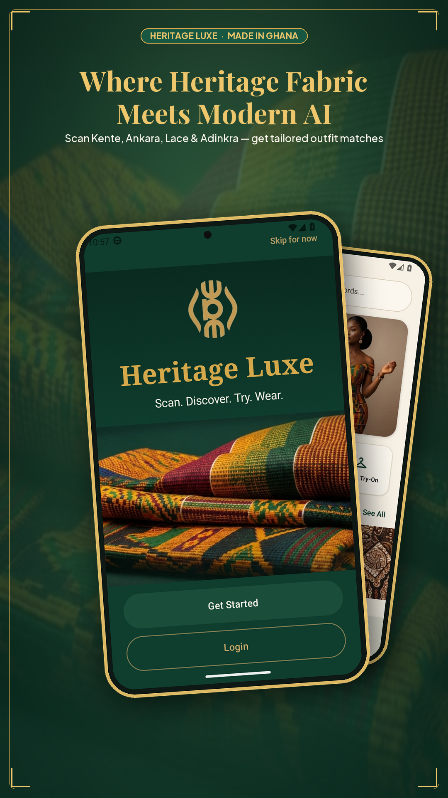<br><sub><strong>01 · Welcome</strong></sub></td>
    <td align="center">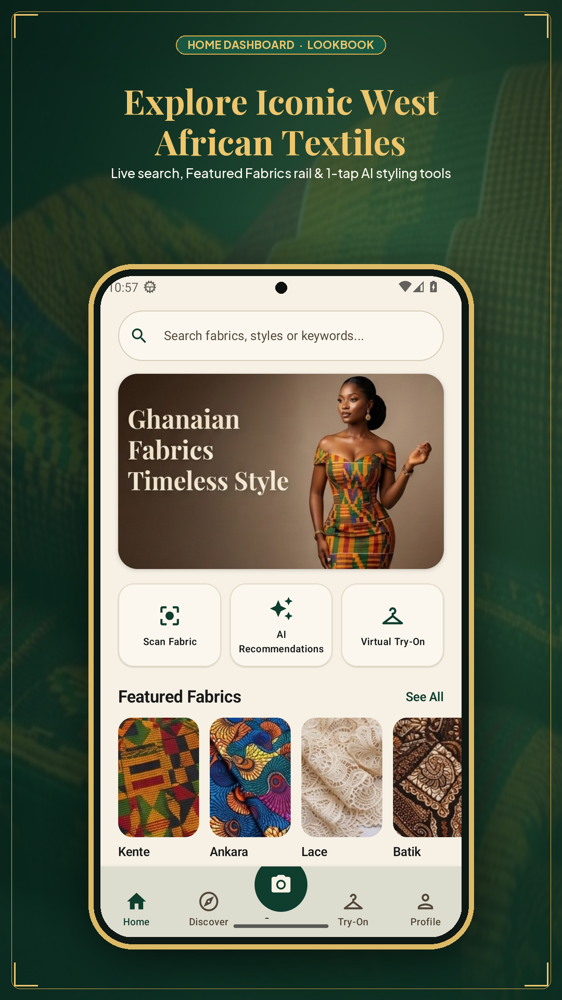<br><sub><strong>02 · Home Lookbook</strong></sub></td>
    <td align="center">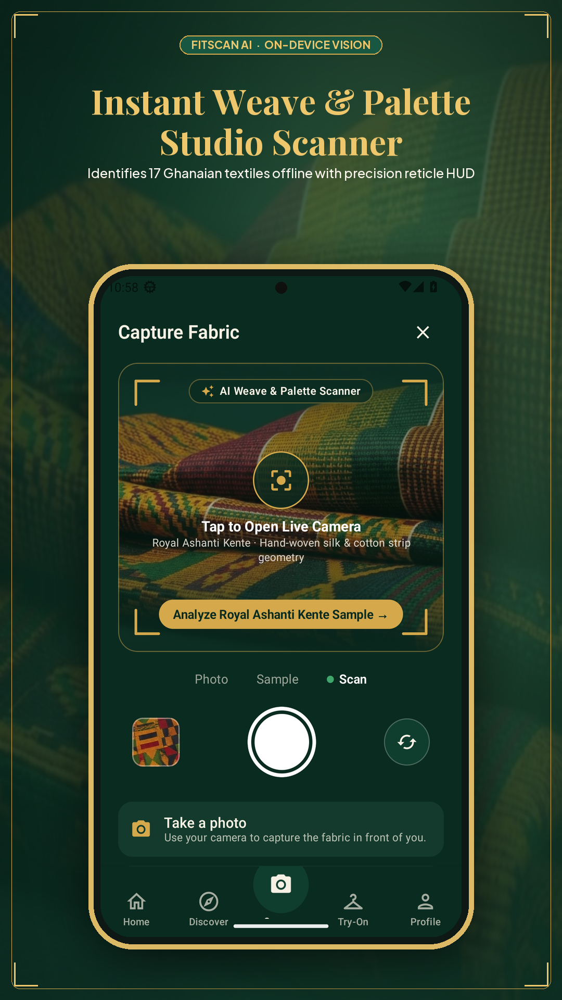<br><sub><strong>03 · FitScan AI</strong></sub></td>
    <td align="center">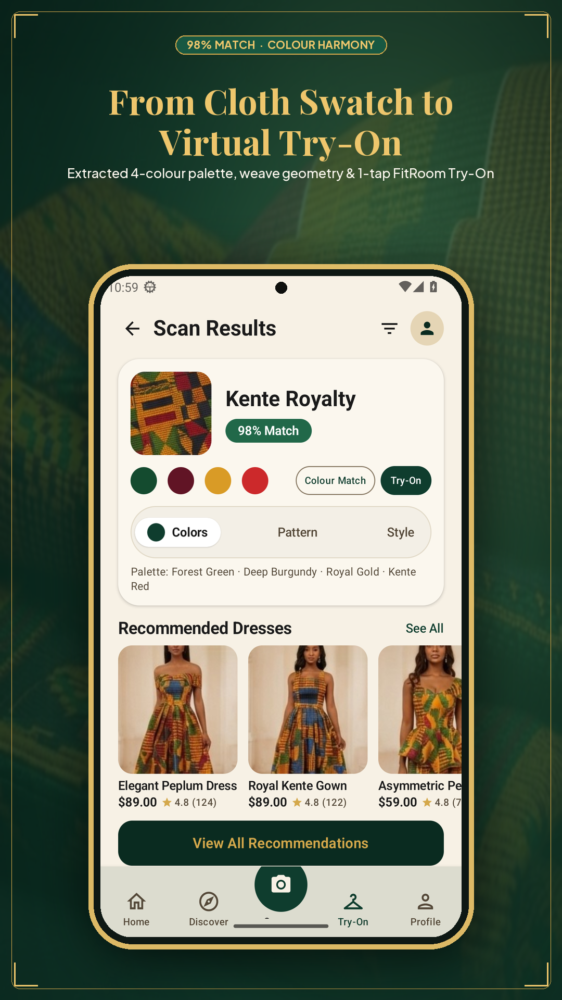<br><sub><strong>04 · Scan Results</strong></sub></td>
    <td align="center">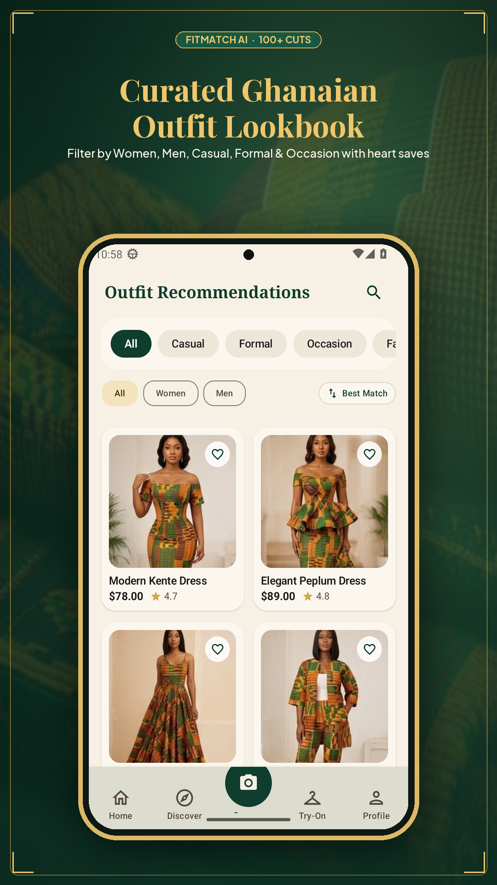<br><sub><strong>05 · FitMatch AI</strong></sub></td>
    <td align="center">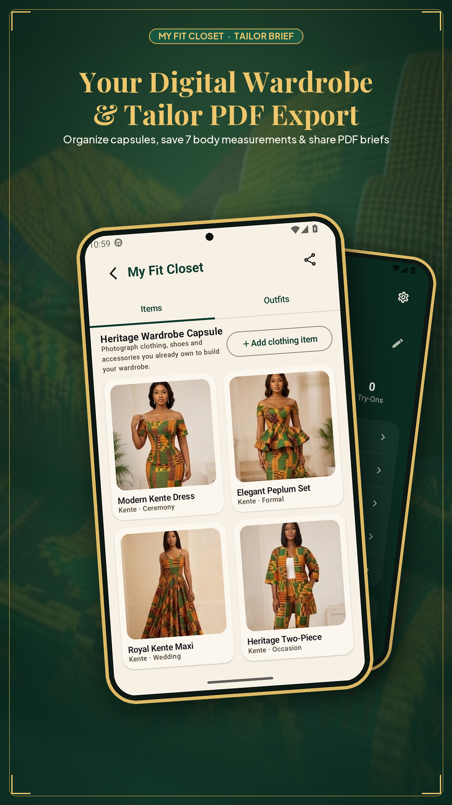<br><sub><strong>06 · My Fit Closet</strong></sub></td>
  </tr>
</table>

---

## About FabricFit

**FabricFit** (design system codename **Heritage Luxe**) is a cultural fashion and textile-intelligence Android app built in **Kotlin + Jetpack Compose** in **Accra, Ghana**. It celebrates the artistry of Ghanaian and West African textiles — **Kente**, **Ankara / Wax Print**, **Adinkra**, **Lace**, **Batik**, **Brocade**, and **Northern Fugu / Gonja smock weaves** — and turns every piece of cloth you own into a tailored outfit brief.

1. **Scan (`FitScan`)** — Point your camera at any fabric. On-device computer vision classifies the weave, extracts its dominant colour palette, and identifies pattern geometry and drape texture.
2. **Discover (`FitMatch AI`)** — Browse curated Ghanaian styles (*Kaba & Slit*, *Modern Kente Dress*, *Elegant Peplum*, *Maxi Gown*, *Two-Piece Co-ord*, *Royal Agbada*, *Senator*, *Northern Smock*) ranked by confidence score and occasion.
3. **Try (`FitRoom`)** — Visualise how your scanned cloth drapes on a model or your own photo before visiting your seamstress or tailor.
4. **Wear (`My Fit Closet`)** — Curate your wardrobe capsule, record your seven body measurements on-device, and export a shareable PDF design brief for your tailor.

> Formerly known as **Ntoma Studio** (`com.ntoma.studio`, from Akan *ntoma* meaning cloth), the product ships as **FabricFit** (`com.fabricfit.app`). See [`FabricFit/docs/brand_positioning.md`](FabricFit/docs/brand_positioning.md) for naming and brand positioning notes.

---

## UI/UX Design System — *Heritage Luxe*

As the UI/UX design direction for FabricFit, **Heritage Luxe** replaces generic utility templates with an **editorial, culturally grounded design language** inspired by Ghanaian royal textiles and contemporary luxury fashion houses.

### 1. Design Pillars

- **Cultural Authenticity over Generic Templates** — Every surface honours the tactile richness of hand-woven Bonwire/Agotime Kente strips, Adinkra geometry, and vibrant Accra market textiles rather than flat placeholder silhouettes.
- **Gallery-Grade Contrast (Dark Chrome + Warm Daylight)** — Immersive dark **Deep Forest (`#0F3D2E`)** surfaces frame high-drama moments (Welcome, Camera Viewfinder, and Personal Profile), while **Warm Cream (`#F7F1E5`)** daylight surfaces provide an editorial lookbook feel for browsing fabrics, colour palettes, and outfit recommendations.
- **One-Thumb Capture Loop** — The 5-tab bottom navigation anchors a raised **60dp Deep Forest Camera FAB** at the centre so scanning a fabric in a market stall or tailor's shop is always a single tap away.

### 2. Colour Architecture & Ghanaian Cultural Semiotics

| Token | Hex | Swatch Role & Cultural Meaning |
| --- | --- | --- |
| `HeritageForest` | `#0F3D2E` | **Primary Brand Surface & Active States** — Inspired by *Kwaeɛ* (Ghana's lush forest canopy, growth, and renewal). Used for the Welcome hero, raised Camera FAB, active filter pills, and match badges. |
| `HeritageForestDark` | `#0A2B20` | **Immersive Dark Chrome** — Used on the Capture Fabric viewfinder and the dark luxury Profile experience so vibrant Kente weaves command full visual focus. |
| `HeritageGold` | `#D4A84B` | **Royal Accent & Brand Monogram** — Inspired by *Sika Futuro* (Ashanti gold dust, royalty, and prestige). Used for the Adinkra-inspired monogram, *Heritage Luxe* serif wordmark, star ratings, and primary CTA highlights. |
| `HeritageGoldSoft` | `#C8A96A` | **Secondary Accent on Dark Surfaces** — Used for outlined pill buttons, avatar rings, and secondary labels on Deep Forest backgrounds. |
| `HeritageCream` | `#F7F1E5` | **Daylight App Canvas** — Inspired by unbleached raw cotton and raffia. Replaces stark `#FFFFFF` with a warm, sunlit editorial paper background. |
| `HeritageCreamBright` | `#FBF7EE` | **Elevated Card Surface** — Used for quick-action tiles, outfit cards, and the Scan Results summary sheet, paired with a `1dp` warm stone border (`#E4DAC6`). |
| `HeritageInk` | `#1A1A1A` | **Primary Editorial Copy** — High-contrast charcoal ink for headlines, prices, and body copy on Warm Cream surfaces. |
| `HeritageBurgundy` & `HeritageRed` | `#611425` / `#CC292B` | **Kente Weave Accents** — Extracted palette tokens reflecting ceremonial Asante Kente crimson and deep wine threads. |

### 3. Typography & Visual Hierarchy

| Tier | Typeface Style | Application |
| --- | --- | --- |
| **Brand & Section Display** | **High-Contrast Editorial Serif** (`FontFamily.Serif`) | *Heritage Luxe* splash wordmark, *Ghanaian Fabrics · Timeless Style* hero banner, *Outfit Recommendations* and screen headers. |
| **UI Controls & Commerce Metadata** | **Clean Geometric Sans-Serif** (`FontFamily.SansSerif`) | Search bar, filter chips (`All · Casual · Formal · Occasion`), confidence badges (`98% Match`), pricing (`$78.00 – $140.00`), and star ratings (`★ 4.8`). |
| **Multilingual Readability** | **Unicode-Complete Sans** | Engineered for seamless rendering across **English**, **Twi (`tw`, ɛ/ɔ glyphs)**, **Ga (`gaa`, ŋ/ɛ/ɔ)**, and **Ewe (`ee`, ɖ/ƒ/ɣ/ŋ/ɔ/ʋ)**. |

### 4. Brand Monogram (`HeritageLuxeMark`)

The splash emblem and brand mark is a custom symmetrical **Adinkra-inspired monogram** rendered in Royal Gold (`#D4A84B`) on Deep Forest (`#0F3D2E`). Its central eye disk, vertical loom spine, three-pronged crown, and flanking woven wings symbolise the union of traditional loom craftsmanship and modern AI vision.

---

## Real App UI (Current Android Source)

Every frame below is an **unretouched capture of the running app**, taken on an
**API 33 emulator at 1080 × 1920** by the `screenshots` job in
[`.github/workflows/build.yml`](.github/workflows/build.yml): the debug APK is
installed, the first-run onboarding is dismissed, each bottom-nav tab is opened
by tapping its real label, and `adb screencap` writes the frame straight into
[`FabricFit/docs/screenshots/`](FabricFit/docs/screenshots/). No mockups, no
photo editing — if the UI changes, the pictures change with it on the next run.

These captures track the branch that triggered the screenshot job. The
[downloadable release](#download-the-apk) is updated only for a version tag,
manual dispatch, or `[release]` commit, so a newer branch can temporarily be
ahead of the latest published APK.

<table>
  <tr>
    <td align="center"><br><strong>1. Welcome / Splash</strong><br><sub>Deep Forest canvas, gold Adinkra monogram, folded Kente hero &amp; pill CTAs</sub></td>
    <td align="center"><br><strong>2. Home Dashboard</strong><br><sub>Search pill, editorial Kente banner, quick-action tiles &amp; Featured Fabrics</sub></td>
    <td align="center">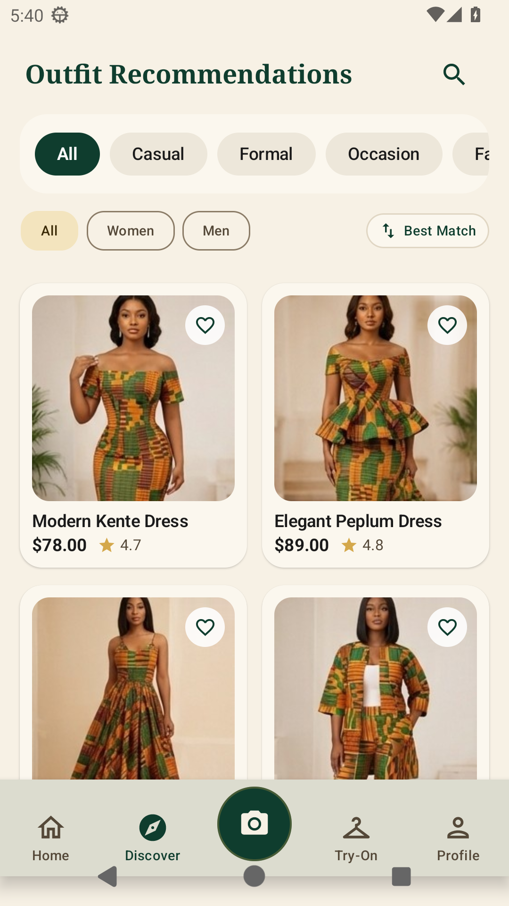<br><strong>3. Discover (FitMatch AI)</strong><br><sub>Occasion filter pills over the 2-column Ghanaian lookbook grid</sub></td>
  </tr>
  <tr>
    <td align="center"><br><strong>4. Capture Fabric (FitScan)</strong><br><sub>Dark forest camera chrome, viewfinder &amp; Photo/Sample/Scan switcher</sub></td>
    <td align="center"><br><strong>5. Virtual Try-On (FitRoom)</strong><br><sub>Person photo, fabric and garment selection with customisation controls</sub></td>
    <td align="center">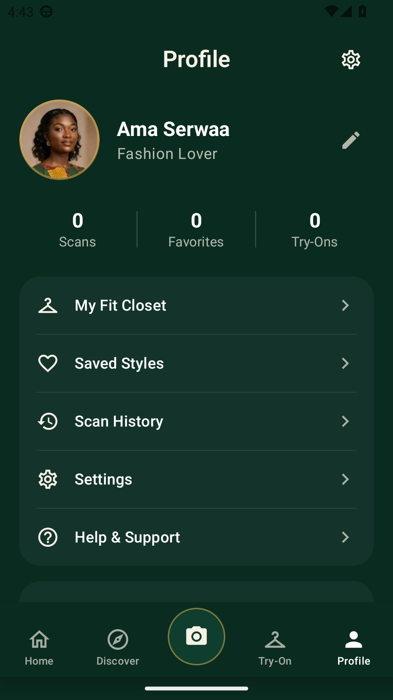<br><strong>6. Profile</strong><br><sub>Deep Forest dark luxury profile, avatar, stats &amp; wardrobe menu</sub></td>
  </tr>
  <tr>
    <td align="center">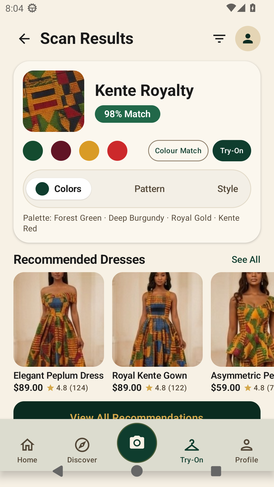<br><strong>7. Scan Results (FitScan)</strong><br><sub>Fabric match, colour palette, inspector tabs &amp; recommended dresses</sub></td>
    <td align="center">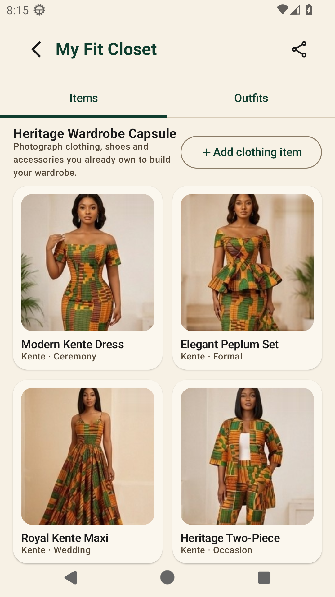<br><strong>8. My Fit Closet</strong><br><sub>Items / Outfits tabs, add-item CTA &amp; starter capsule grid</sub></td>
    <td></td>
  </tr>
</table>

### System Insets, Text Scaling & Responsive QA

The same capture job explicitly enables **Android 3-button navigation**. It also
captures Home at **130% font scale**, on a **720 × 1280** smaller display, and in
**1920 × 1080 landscape**. The bottom bar respects the user's font scale and grows
instead of clipping enlarged labels.

<table>
  <tr>
    <td align="center"><br><sub><strong>130% text</strong></sub></td>
    <td align="center">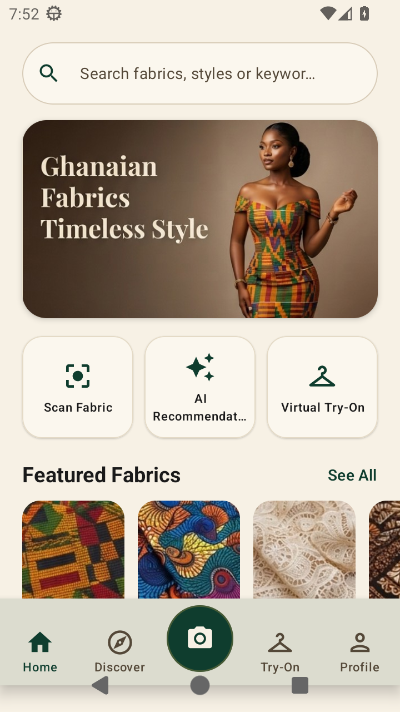<br><sub><strong>Small display</strong></sub></td>
    <td align="center">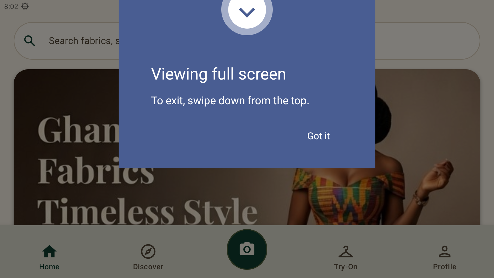<br><sub><strong>Landscape</strong></sub></td>
  </tr>
</table>

---

## Download the APK

Every push and pull request is compiled and tested by GitHub Actions. The
minified **release build** is published to GitHub Releases on version tags,
manual workflow dispatch, or a branch commit marked `[release]`; ordinary branch
builds upload CI artifacts without replacing the public release.

> ### 👉 [Download FabricFit v1.0.2 (APK)](https://github.com/Jacinth-19/fabricfit-app/releases/latest/download/fabricfit-v1.0.2.apk)
>
> [`releases/latest`](https://github.com/Jacinth-19/fabricfit-app/releases/latest) also carries `fabricfit-v1.0.2.aab` for a Play upload.

```bash
# install on a connected phone or a running emulator
adb install -r fabricfit-v1.0.2.apk
```

| What | Where it comes from | Notes |
| --- | --- | --- |
| **Release APK** (`fabricfit-v1.0.2.apk`) | `release` job → GitHub Releases | R8-minified, `armeabi-v7a` + `arm64-v8a`, `minSdk 24` (Android 7.0+). |
| **Release bundle** (`fabricfit-v1.0.2.aab`) | same release | The artifact you would upload to the Play Console. |
| **Debug APK** | run → artifact `fabricfit-debug-apk` | `com.fabricfit.app.debug`, debuggable, for testers without a release key. |
| **Instrumented test report** | run → artifact `test-reports` | Unit-test and lint output for the run. |

> **Signing** — `signingConfigs.release` in `FabricFit/app/build.gradle.kts`
> reads `KEYSTORE_FILE` / `KEYSTORE_PASSWORD` / `KEY_ALIAS` / `KEY_PASSWORD`
> from Gradle properties or environment variables (and the CI `release` job
> decodes an optional `KEYSTORE_BASE64` secret). When unset, it falls back to
> the throwaway demo keystore at `FabricFit/app/demo-release.keystore`, so the
> APK installs on any device out of the box. The demo key is for testing only;
> setting repository variable `PRODUCTION_RELEASE=true` makes real signing secrets
> mandatory and blocks demo-signed Play artifacts. See
> [`FabricFit/docs/PRODUCTION_SIGNING.md`](FabricFit/docs/PRODUCTION_SIGNING.md).

### Continuous Integration

[`.github/workflows/build.yml`](.github/workflows/build.yml) is the single
pipeline (the older `android-ci.yml` is kept only for reference):

| Job | Trigger | What it does |
| --- | --- | --- |
| `verify` | every push & PR (paths under `FabricFit/**`) | `./gradlew :app:testDebugUnitTest :app:assembleDebug :app:assembleDebugAndroidTest`, then uploads the debug APK and test reports. Gradle failures are annotated inline on the commit. |
| `release` | after `verify` | `:app:assembleRelease :app:bundleRelease` with R8 (using `KEYSTORE_BASE64` when set, otherwise `demo-release.keystore`), uploads both artifacts, and publishes them to the `v*` GitHub Release on tags, manual dispatch, or a push whose commit message contains `[release]`. |
| `device-qa` | manual, weekly, or on `v*` tags | Linux runner (`ubuntu-latest`) with KVM & `SCREENSHOT_ABI=1`: boots an API 33 `x86_64` emulator in Android 3-button mode and runs `PersonSegmenterDeviceTest` plus `BottomNavigationInsetTest`. |
| `screenshots` | manual dispatch, or any push whose commit message contains `[screenshots]` | Boots an API 33 emulator, drives the app, and commits fresh PNGs to `FabricFit/docs/screenshots/`. |

```bash
# refresh the screenshots in this README yourself
git commit --allow-empty -m "chore: refresh screenshots [screenshots]" && git push
```

---

## Screen-by-Screen Breakdown

The notes below refer to the genuine emulator captures in
[`FabricFit/docs/screenshots/`](FabricFit/docs/screenshots/), not separate design
mockups.

1. **Welcome / Splash ([`welcome.png`](FabricFit/docs/screenshots/welcome.png) → `OnboardingScreen.kt`)**
   - Full-bleed Deep Forest (`#0F3D2E`) atmosphere with the Royal Gold Adinkra monogram (`HeritageLuxeMark`), *Heritage Luxe* serif title, and *Scan. Discover. Try. Wear.* value proposition.
   - Anchored by photorealistic stacked folds of hand-woven Kente cloth and dual full-width pill CTAs (**Get Started** in tonal forest green and **Login** in outlined muted gold).
2. **Home Dashboard ([`home.png`](FabricFit/docs/screenshots/home.png) → `HomeScreen.kt`)**
   - Opens on a Warm Cream (`#F7F1E5`) canvas with a rounded global search pill (*"Search fabrics, styles or keywords…"*).
   - Features the *"Ghanaian Fabrics · Timeless Style"* editorial hero banner, three balanced quick-action cards (**Scan Fabric**, **AI Matches**, **Virtual Try-On**), and a horizontal **Featured Fabrics** rail (**Kente**, **Ankara**, **Lace**, **Batik**, **Adinkra**).
3. **Capture Fabric ([`create.png`](FabricFit/docs/screenshots/create.png) → `CreateScreen.kt` & `CameraScreen.kt`)**
   - Uses dark forest chrome (`#0A2B20`) to eliminate glare while inspecting textile threads.
   - Pairs a macro Kente viewfinder frame with a **Photo · Sample · ● Scan** mode indicator, a quick-access swatch gallery thumbnail, a double-ring shutter button, and a sample-fabric switcher.
4. **Virtual Try-On ([`try-on.png`](FabricFit/docs/screenshots/try-on.png) → `TryOnScreen.kt`)**
   - The bottom **Try-On** tab opens the actual FitRoom flow, not the Scan Results screen.
   - Guides the user through a person photo, fabric and garment selection, customisation, and generation; Saved Styles remains available from Profile.
5. **Scan Results ([`scan-results.png`](FabricFit/docs/screenshots/scan-results.png) → `FavoritesScreen.kt` & `FabricDetailScreen.kt`)**
   - Summarises the identified weave (**Kente Royalty**) alongside a high-contrast **`98% Match`** pill badge and four extracted colour swatches (forest green, deep burgundy, royal gold, Kente crimson).
   - Provides a segmented **Colors · Pattern · Style** inspector, a **Recommended Dresses** horizontal carousel with star ratings and review counts, and a full-width gold-on-forest **View All Recommendations** CTA.
6. **Outfit Recommendations ([`discover.png`](FabricFit/docs/screenshots/discover.png) → `DiscoverScreen.kt` & `RecommendationsScreen.kt`)**
   - Pairs an editorial serif title with pill filter chips (**All**, **Casual**, **Formal**, **Occasion**, **Fabrics**).
   - Displays a two-column lookbook grid (*Modern Kente Dress*, *Elegant Peplum Dress*, *Maxi Dress*, *Two-Piece Set*) with favourite heart affordances, tailoring price estimates, and gold star ratings.
7. **Profile ([`profile.png`](FabricFit/docs/screenshots/profile.png) → `ProfileScreen.kt`)**
   - Returns to the intimate Deep Forest dark palette with a gold-ringed circular portrait (**Ama Serwaa — Fashion Lover**), a three-column activity summary for scans, favourites and try-ons, and translucent dark cards leading to **My Fit Closet**, **Saved Styles**, **Scan History**, **Settings**, and **Help & Support**.
8. **My Fit Closet ([`my-fit-closet.png`](FabricFit/docs/screenshots/my-fit-closet.png) → `WardrobeScreen.kt`)**
   - Provides Items / Outfits tabs, wardrobe capture, capsule organisation, measurements, and tailor-brief export.

---

## Feature Suite

| Feature | In-App Name | What It Does |
| --- | --- | --- |
| Camera scanner | **FitScan** | Photograph any fabric; on-device ML classifies the textile and extracts its palette, pattern, and texture. |
| AI recommendation engine | **FitMatch AI** | Ranks outfit designs against your fabric with a confidence % and plain-language reasoning; filterable by occasion and category. |
| Virtual try-on | **FitRoom** | Drapes the scanned fabric onto a model or your own photo so you can preview the finished garment before you sew. |
| Wardrobe & saved items | **My Fit Closet** | Organises your wardrobe capsule, saved styles, scan history, body measurements, and shareable PDF tailor briefs. |

---

## Navigation Map (29 Screens)

The app ships **29 screens**: 28 registered in the navigation graph plus the first-run Welcome/Onboarding gate. Routes are declared in [`ui/navigation/Destinations.kt`](FabricFit/app/src/main/java/com/fabricfit/app/ui/navigation/Destinations.kt) and wired up in [`ui/navigation/FabricFitNavHost.kt`](FabricFit/app/src/main/java/com/fabricfit/app/ui/navigation/FabricFitNavHost.kt).

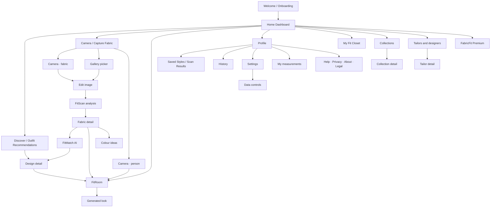

---

## AI & Machine Learning Architecture

FabricFit pairs an offline-first on-device computer-vision and ML pipeline with an optional cloud backend contract:

| # | AI / ML Capability | Bundled `.tflite` Assets (`app/src/main/assets/`) | Core Implementation | What It Computes |
| --- | --- | --- | --- | --- |
| **1** | **Ghanaian Textile Classifier with OOD Uncertainty** | • `ghanaian_fabric_classifier.tflite` (`85.5 KB`, `[1,128,128,3] -> [1,17]`)<br>• `ghanaian_fabric_labels.txt` (17 classes)<br>• `mobilenet_v2_1.0_224_quant.tflite` (`3.5 MB`, `[1,224,224,3] -> [1,1001]`) | `OnDeviceMlClassifier.kt` & `FabricAnalysisRepositoryImpl.kt` | • Dedicated 17-class Ghanaian & West African textile classifier (`ADINKRA`, `ANKARA`, `BATIK`, `BROCADE`, `CHIFFON`, `COTTON_PLAIN`, `DENIM`, `FUGU`, `GONJA`, `KENTE`, `KENTE_PRINT`, `LACE`, `LINEN`, `SILK`, `TIEDYE`, `VELVET`, `WAX`).<br>• Temperature-scaled softmax, normalized Shannon entropy ($H / \ln K$), top-1/top-2 margin gating, and out-of-distribution (`NON_TEXTILE_DOMINANT`) rejection via MobileNetV2. |
| **2** | **Multi-Scale Weave & Motif Periodicity Analyzer** | • `weave_motif_extractor.tflite` (`16.1 KB`, `[1,128,128,3] -> [1,6]`) | `TextureMetrics.kt`, `ColorPatternAnalyzer.kt` & `OnDeviceMlClassifier.kt` | • 24-filter Gabor directional conv bank (`0°`, `45°`, `90°`, `135°` across 3 wavelengths) + `gaborOrientation(...)` (`GaborOrientationProfile`).<br>• `spectralMotifProfile(...)` (`SpectralMotifProfile`): 1D DFT autocorrelation harmonic purity, normalized strip width, motif repeat pitch (`repeatX`, `repeatY`), and tailoring `AlignmentAdvice`. |
| **3** | **Human Parsing & Skin-Tone Segmentation** | • `selfie_segmentation.tflite` (`243.7 KB`, MediaPipe `[1,256,256,3] -> [1,256,256,1]`)<br>• `human_parsing_5class.tflite` (`35.8 KB`, `[1,128,128,3] -> [1,128,128,5]`)<br>• `deeplabv3_257_mv.tflite` (`2.7 MB`, `[1,257,257,3] -> [1,257,257,21]`) | `PersonSegmenter.kt` & `ColorHarmonyEngine.kt` | • Fuses MediaPipe Selfie Segmentation, DeepLabV3, and the 5-class human parser (`BACKGROUND`, `HEAD_AND_FACE`, `UPPER_GARMENT`, `LOWER_GARMENT`, `SKIN_EXPOSED`).<br>• Extracts wearer `dominantSkinArgb` and `SkinUndertone` (`WARM_GOLDEN`, `COOL_DEEP`, `NEUTRAL_RICH`) for `ColorHarmonyEngine.skinHarmonyScore(...)` & `suggestForWearer(...)`. |
| **4** | **Texture-Preserving Cloth Warper for Virtual Try-On** | • `cloth_warper_shading.tflite` (`11.9 KB`, `[1,64,64,4] -> [1,64,64,3]`) | `DemoLookGenerator.kt`, `GarmentGeometry.kt` & `CloudAnalysisClient.kt` | • Seamless `160×160` mirror-tiled real fabric swatch extraction (`loadRealFabricTextureOrFallback`), dynamic sleeve/neckline/length polygon reshaping, 3D cylindrical + neural fold shading (`predictClothShadingMap`), head/face pixel preservation, and `POST v1/tryon` cloud VTON contract. |
| **5** | **Context-Aware FitMatch AI Ranker** | • `fitmatch_ranker.tflite` (`6.5 KB`, `[1,16] -> [1,1]`) | `RecommendationEngine.kt` & `RecommendationsViewModel.kt` | • 16-feature neural ranker MLP (`buildFeatureVector`) fused with `RecommendationContext` (fabric structure, wearer skin-tone harmony, `Measurements` waist-to-hip & height proportions, Gabor weave anisotropy, and session favorite style affinity). |

---

## Repository Layout

```
FabricFit/          Android app (Kotlin + Jetpack Compose), package com.fabricfit.app
  app/              app module — Heritage Luxe UI, domain engines, Room DB, on-device ML
  docs/             brand positioning, Play readiness, device QA, research notes,
                    screenshots/ (real API 33 emulator captures)
  store/            Play listing copy, icon and feature graphic, privacy policy
  tools/            i18n packs (en, tw, gaa, ee), dataset pipeline, mock backend
tools/              sandbox toolchain bootstrap & emulator screenshot capture scripts
```

## Build & Verify

```bash
bash tools/setup_toolchain.sh
cd FabricFit
./gradlew :app:testDebugUnitTest :app:assembleDebug :app:assembleDebugAndroidTest
```

That is exactly what the `verify` job runs in CI. To build the minified,
signed APK locally: `./gradlew :app:assembleRelease` →
`app/build/outputs/apk/release/app-release.apk` (or grab the prebuilt one under
[**Download the APK**](#download-the-apk)).

Full build instructions, release signing, and verification notes: [`FabricFit/BUILD.md`](FabricFit/BUILD.md).

## Ghanaian Languages (`i18n`)

FabricFit ships with full string translations in **English**, **Twi (`tw`)**, **Ga (`gaa`)**, and **Ewe (`ee`)**. Translation packs live in `FabricFit/tools/i18n/`; validate and regenerate XML resources with:

```bash
cd FabricFit
python3 tools/i18n/generate.py
```

---

## Taglines

| Context | Line |
| --- | --- |
| **Welcome Hero** | Scan. Discover. Try. Wear. |
| **Heritage Luxe Editorial** | Where Ghanaian Heritage Fabric Meets Modern Style. |
| **Primary Product Line** | Scan Your Fabric. Wear Your Style. |
| **Tech-Focused** | AI-Powered Ghanaian Fabric & Outfit Matching. |

Made with pride in **Accra, Ghana** 🇬🇭
