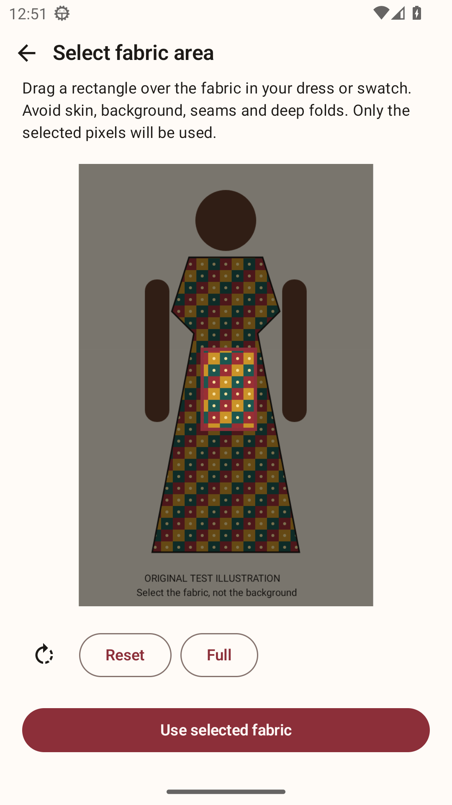
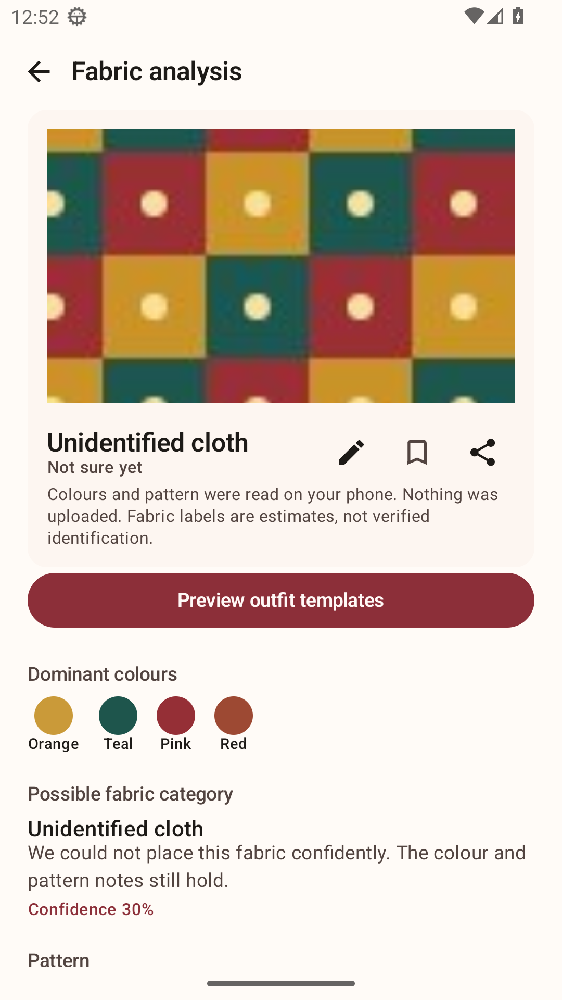
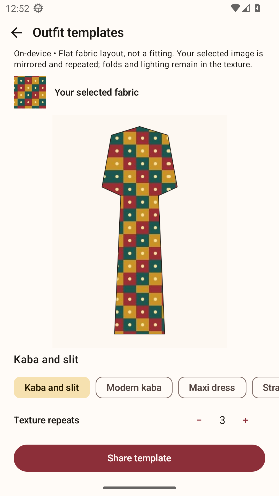
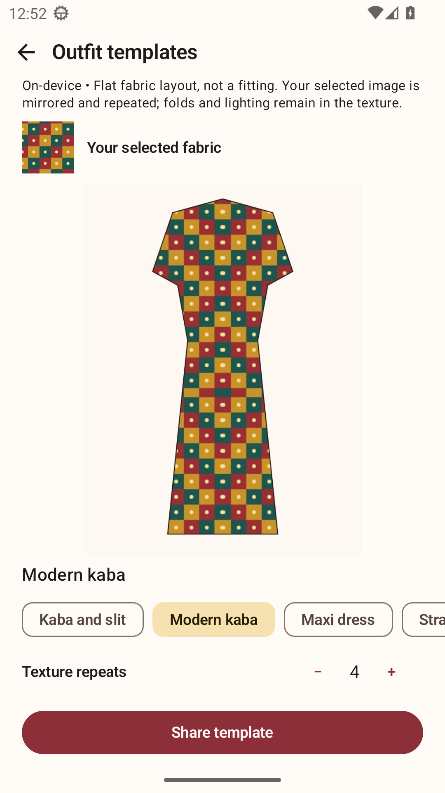

# Ntoma Studio

**Turn the fabric you already own into your next outfit idea.**

Ntoma Studio is an Android app for exploring fabric colours, patterns and outfit layouts. Start with a photo of a fabric swatch—or fabric in an existing dress—select the area you want to use, and see it applied to outfit templates.

### Try the app

**[Download the Android APK](https://github.com/Jacinth-19/ntoma-studio/releases/download/debug-latest/app-debug.apk)** · [Release notes](https://github.com/Jacinth-19/ntoma-studio/releases/tag/debug-latest)

The current download is an **English-language test build** for Android 7.0 or newer. Download it on your phone, open the APK, and allow installation from that source if Android asks. It is not yet a Google Play release.

## A look inside

These are screenshots of the actual app running on Android. The dress shown is an original test illustration, used to demonstrate fabric selection.

<table>
  <tr>
    <td align="center"><strong>1. Select your fabric</strong></td>
    <td align="center"><strong>2. Explore colours and patterns</strong></td>
  </tr>
  <tr>
    <td align="center"></td>
    <td align="center"></td>
  </tr>
  <tr>
    <td align="center"><strong>3. Preview an outfit template</strong></td>
    <td align="center"><strong>4. Adjust texture repeats</strong></td>
  </tr>
  <tr>
    <td align="center"></td>
    <td align="center"></td>
  </tr>
</table>

## What you can do

- **Take or choose a photo.** Use the camera or gallery with a swatch or an existing outfit.
- **Choose the fabric area.** Drag a rectangle to isolate the texture you want, rather than using the whole photo.
- **Explore your fabric.** See dominant colours, pattern observations and an estimated fabric category.
- **Try outfit layouts.** Apply the selected texture to different garment templates and adjust how often it repeats.
- **Share an idea.** Export the template to discuss the look with a tailor or friend.

### How to get a useful preview

Choose a clear, evenly lit fabric area. Avoid skin, backgrounds, seams and deep folds where possible. The app uses the pixels you select, so lighting and folds in the photo remain in the texture.

## What to expect

Templates are **flat outfit previews**, intended to help you explore a design—not a prediction of fit or a photorealistic try-on. Fabric identification is an estimate, not a verified material assessment. Cloud photoreal try-on is not available in this build.

The default fabric analysis and template workflow run **on your phone without uploading your photos**. If you explicitly configure and select the optional cloud-analysis endpoint, the selected fabric image is sent to that endpoint. Sharing a template is your choice.

English is the current launch language. Twi, Ga and Ewe drafts are preserved for future native-language review; they are not included in the app yet.

## For developers

The Android project lives in [`NtomaStudio/`](NtomaStudio/). It uses Kotlin, Jetpack Compose and an on-device LiteRT model, with Android 7.0 as the minimum supported version and API 36 as the target.

With JDK 17 and Android SDK 36 installed:

```sh
cd NtomaStudio
bash gradlew :app:assembleDebug :app:testDebugUnitTest
```

GitHub Actions builds the app and tests the installed fabric-selection, analysis, template and sharing journey on Android 33 and Android 16 with 16 KB memory pages. The downloadable test APK is refreshed only after the build and both device journeys pass.

- [Build instructions](NtomaStudio/BUILD.md)
- [Verified app workflow and test results](NtomaStudio/docs/VALIDATED_FABRIC_WORKFLOW.md)
- [Production signing and Play release setup](NtomaStudio/docs/PRODUCTION_RELEASE.md)
- [Privacy policy](NtomaStudio/store/privacy_policy.html)
- [Data safety notes](NtomaStudio/docs/PLAY_DATA_SAFETY.md)

Found a problem or have an idea? [Open an issue](https://github.com/Jacinth-19/ntoma-studio/issues).
