# FabricFit — Heritage Luxe

[](https://github.com/Jacinth-19/fabricfit-app/actions/workflows/build.yml)

<div align="center">

### **Scan. Discover. Try. Wear.**
*Where Ghanaian Heritage Fabric Meets Modern Style.*

<table>
  <tr>
    <td align="center">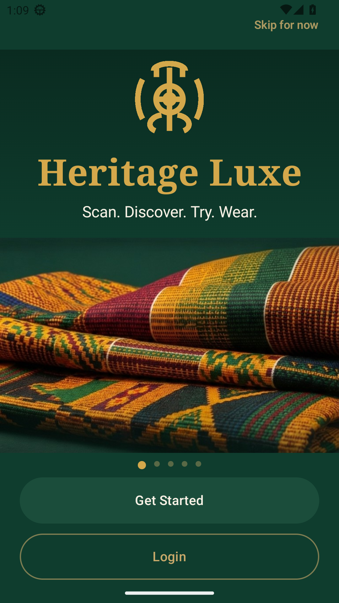<br><sub><strong>Welcome · Heritage Luxe</strong></sub></td>
    <td align="center">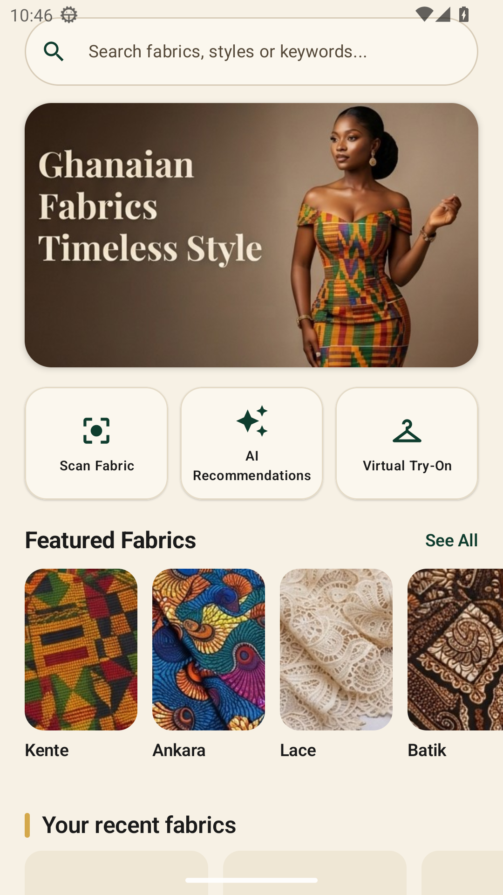<br><sub><strong>Home Dashboard</strong></sub></td>
    <td align="center">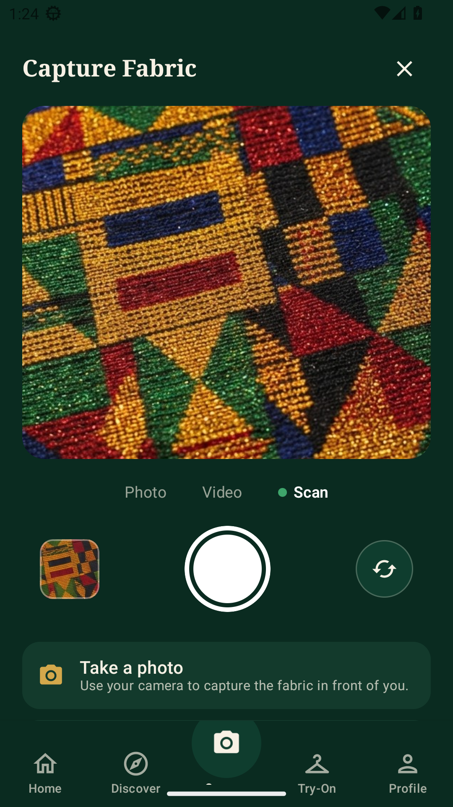<br><sub><strong>FitScan · Capture Fabric</strong></sub></td>
    <td align="center">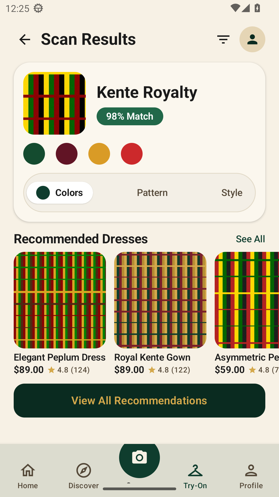<br><sub><strong>FitScan · Scan Results</strong></sub></td>
  </tr>
</table>

</div>

---

## About FabricFit

**FabricFit** (design system codename **Heritage Luxe**) is a cultural fashion and textile-intelligence Android app built in **Kotlin + Jetpack Compose** in **Accra, Ghana**. It celebrates the artistry of Ghanaian and West African textiles — **Kente**, **Ankara / Wax Print**, **Adinkra**, **Lace**, **Batik**, **Brocade**, and **Northern Fugu / Gonja smock weaves** — and turns every piece of cloth you own into a tailored outfit brief.

1. **Scan (`FitScan`)** — Point your camera at any fabric. On-device computer vision classifies the weave, extracts its dominant colour palette, and identifies pattern geometry and drape texture.
2. **Discover (`FitMatch AI`)** — Browse curated Ghanaian styles (*Kaba & Slit*, *Modern Kente Dress*, *Elegant Peplum*, *Maxi Gown*, *Two-Piece Co-ord*, *Royal Agbada*, *Senator*, *Northern Smock*) ranked by confidence score and occasion.
3. **Try (`FitRoom`)** — Visualise how your scanned cloth drapes on a model or your own photo before visiting your seamstress or tailor.
4. **Wear (`My Fit Closet`)** — Curate your wardrobe capsule, record your seven body measurements on-device, and export a shareable PDF design brief for your tailor.

> Formerly known as **Ntoma Studio** (`com.ntoma.studio`, from Akan *ntoma* meaning cloth), the product ships as **FabricFit** (`com.fabricfit.app`). See [`FabricFit/docs/brand_positioning.md`](FabricFit/docs/brand_positioning.md) for naming and brand positioning notes.

---

## UI/UX Design System — *Heritage Luxe*

As the UI/UX design direction for FabricFit, **Heritage Luxe** replaces generic utility templates with an **editorial, culturally grounded design language** inspired by Ghanaian royal textiles and contemporary luxury fashion houses.

### 1. Design Pillars

- **Cultural Authenticity over Generic Templates** — Every surface honours the tactile richness of hand-woven Bonwire/Agotime Kente strips, Adinkra geometry, and vibrant Accra market textiles rather than flat placeholder silhouettes.
- **Gallery-Grade Contrast (Dark Chrome + Warm Daylight)** — Immersive dark **Deep Forest (`#0F3D2E`)** surfaces frame high-drama moments (Welcome, Camera Viewfinder, and Personal Profile), while **Warm Cream (`#F7F1E5`)** daylight surfaces provide an editorial lookbook feel for browsing fabrics, colour palettes, and outfit recommendations.
- **One-Thumb Capture Loop** — The 5-tab bottom navigation anchors a raised **60dp Deep Forest Camera FAB** at the centre so scanning a fabric in a market stall or tailor's shop is always a single tap away.

### 2. Colour Architecture & Ghanaian Cultural Semiotics

| Token | Hex | Swatch Role & Cultural Meaning |
| --- | --- | --- |
| `HeritageForest` | `#0F3D2E` | **Primary Brand Surface & Active States** — Inspired by *Kwaeɛ* (Ghana's lush forest canopy, growth, and renewal). Used for the Welcome hero, raised Camera FAB, active filter pills, and match badges. |
| `HeritageForestDark` | `#0A2B20` | **Immersive Dark Chrome** — Used on the Capture Fabric viewfinder and the dark luxury Profile experience so vibrant Kente weaves command full visual focus. |
| `HeritageGold` | `#D4A84B` | **Royal Accent & Brand Monogram** — Inspired by *Sika Futuro* (Ashanti gold dust, royalty, and prestige). Used for the Adinkra-inspired monogram, *Heritage Luxe* serif wordmark, star ratings, and primary CTA highlights. |
| `HeritageGoldSoft` | `#C8A96A` | **Secondary Accent on Dark Surfaces** — Used for outlined pill buttons, avatar rings, and secondary labels on Deep Forest backgrounds. |
| `HeritageCream` | `#F7F1E5` | **Daylight App Canvas** — Inspired by unbleached raw cotton and raffia. Replaces stark `#FFFFFF` with a warm, sunlit editorial paper background. |
| `HeritageCreamBright` | `#FBF7EE` | **Elevated Card Surface** — Used for quick-action tiles, outfit cards, and the Scan Results summary sheet, paired with a `1dp` warm stone border (`#E4DAC6`). |
| `HeritageInk` | `#1A1A1A` | **Primary Editorial Copy** — High-contrast charcoal ink for headlines, prices, and body copy on Warm Cream surfaces. |
| `HeritageBurgundy` & `HeritageRed` | `#611425` / `#CC292B` | **Kente Weave Accents** — Extracted palette tokens reflecting ceremonial Asante Kente crimson and deep wine threads. |

### 3. Typography & Visual Hierarchy

| Tier | Typeface Style | Application |
| --- | --- | --- |
| **Brand & Section Display** | **High-Contrast Editorial Serif** (`FontFamily.Serif`) | *Heritage Luxe* splash wordmark, *Ghanaian Fabrics · Timeless Style* hero banner, *Outfit Recommendations* and screen headers. |
| **UI Controls & Commerce Metadata** | **Clean Geometric Sans-Serif** (`FontFamily.SansSerif`) | Search bar, filter chips (`All · Casual · Formal · Occasion`), confidence badges (`98% Match`), pricing (`$78.00 – $140.00`), and star ratings (`★ 4.8`). |
| **Multilingual Readability** | **Unicode-Complete Sans** | Engineered for seamless rendering across **English**, **Twi (`tw`, ɛ/ɔ glyphs)**, **Ga (`gaa`, ŋ/ɛ/ɔ)**, and **Ewe (`ee`, ɖ/ƒ/ɣ/ŋ/ɔ/ʋ)**. |

### 4. Brand Monogram (`HeritageLuxeMark`)

The splash emblem and brand mark is a custom symmetrical **Adinkra-inspired monogram** rendered in Royal Gold (`#D4A84B`) on Deep Forest (`#0F3D2E`). Its central eye disk, vertical loom spine, three-pronged crown, and flanking woven wings symbolise the union of traditional loom craftsmanship and modern AI vision.

---

## Real App UI (Shipped Android Build)

Below are **unretouched screenshots of the running FabricFit Android app**, captured automatically by GitHub Actions on an **API 33 Pixel 2 emulator (1080 × 1920)** after implementing the **Heritage Luxe** UI/UX redesign in Jetpack Compose.

<table>
  <tr>
    <td align="center"><br><strong>1. Welcome / Splash</strong><br><sub>Deep Forest canvas, gold Adinkra monogram, folded Kente hero &amp; pill CTAs</sub></td>
    <td align="center"><br><strong>2. Home Dashboard</strong><br><sub>Search pill, editorial Kente banner, 3 quick-action tiles &amp; Featured Fabrics</sub></td>
    <td align="center"><br><strong>3. Capture Fabric (FitScan)</strong><br><sub>Dark forest camera chrome, macro Kente viewfinder &amp; Photo/Video/Scan switcher</sub></td>
  </tr>
  <tr>
    <td align="center"><br><strong>4. Scan Results</strong><br><sub>Kente Royalty 98% Match card, 4 colour swatches, segmented tabs &amp; dress rail</sub></td>
    <td align="center">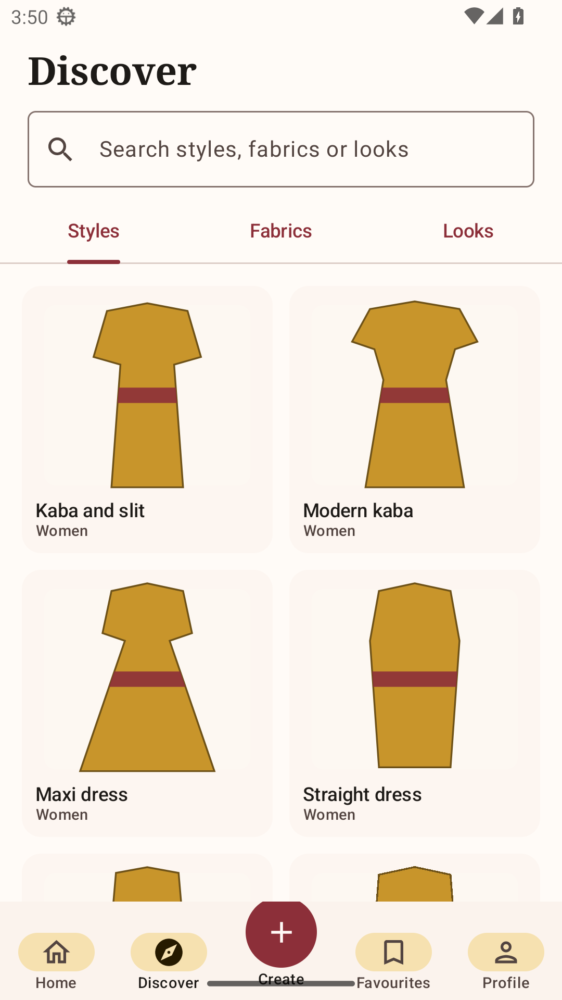<br><strong>5. Outfit Recommendations</strong><br><sub>Occasion filter pills &amp; 2-column Ghanaian lookbook grid with ratings</sub></td>
    <td align="center">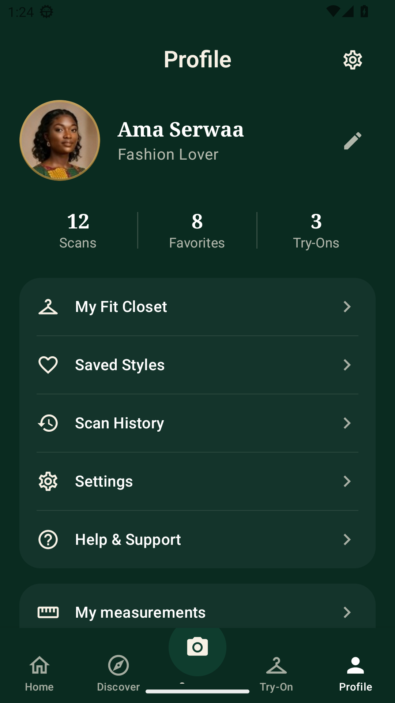<br><strong>6. Profile</strong><br><sub>Deep Forest dark luxury profile, Ama Serwaa avatar, stats &amp; wardrobe menu</sub></td>
  </tr>
</table>

<p align="center">
  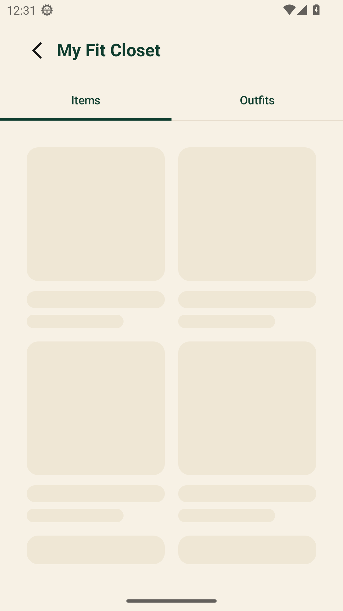<br>
  <strong>7. My Fit Closet (Heritage Wardrobe Capsule)</strong><br>
  <sub>Curated Ghanaian wardrobe capsule &amp; custom garment organiser</sub>
</p>

---

## UI/UX Reference Mockups & Screen-by-Screen Breakdown

The six high-fidelity design reference boards that guided the **Heritage Luxe** transformation are archived in [`FabricFit/docs/heritage-luxe-mockups/`](FabricFit/docs/heritage-luxe-mockups/):

<table>
  <tr>
    <td align="center"><br><strong>Ref 01 · Welcome / Splash</strong></td>
    <td align="center"><br><strong>Ref 02 · Home Dashboard</strong></td>
    <td align="center">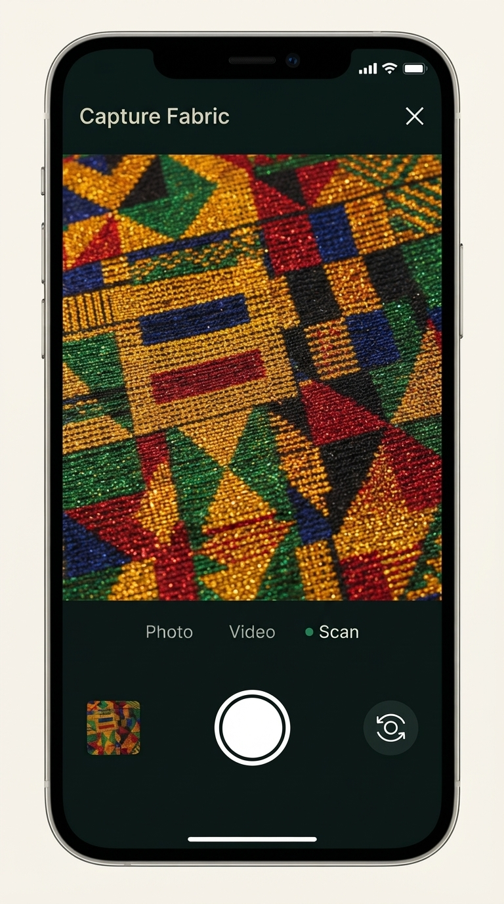<br><strong>Ref 03 · Capture Fabric</strong></td>
  </tr>
  <tr>
    <td align="center"><br><strong>Ref 04 · Scan Results</strong></td>
    <td align="center">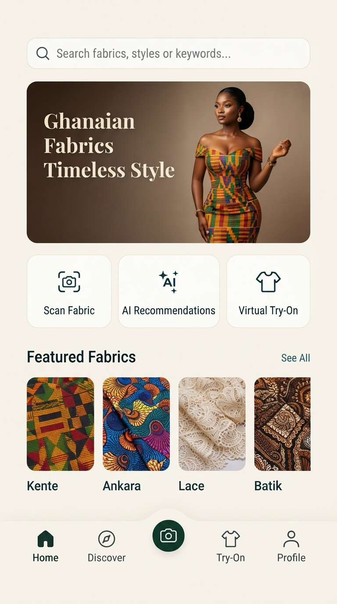<br><strong>Ref 05 · Outfit Recommendations</strong></td>
    <td align="center">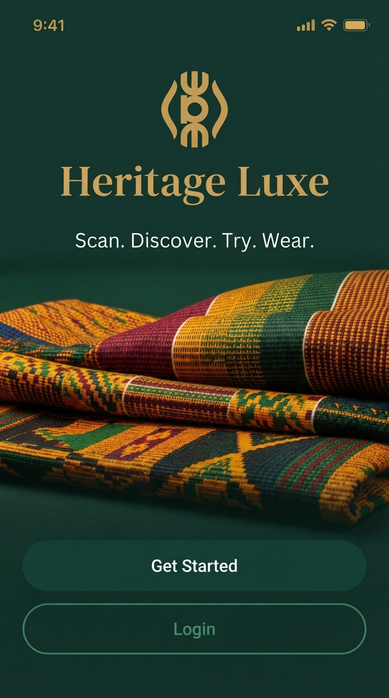<br><strong>Ref 06 · Profile</strong></td>
  </tr>
</table>

### Screen UX Notes

1. **Welcome / Splash (`01-splash-welcome.jpg` → `OnboardingScreen.kt`)**
   - Full-bleed Deep Forest (`#0F3D2E`) atmosphere with the Royal Gold Adinkra monogram (`HeritageLuxeMark`), *Heritage Luxe* serif title, and *Scan. Discover. Try. Wear.* value proposition.
   - Anchored by photorealistic stacked folds of hand-woven Kente cloth and dual full-width pill CTAs (**Get Started** in tonal forest green and **Login** in outlined muted gold).
2. **Home Dashboard (`02-home-dashboard.jpg` → `HomeScreen.kt`)**
   - Opens on a Warm Cream (`#F7F1E5`) canvas with a rounded global search pill (*"Search fabrics, styles or keywords…"*).
   - Features the *"Ghanaian Fabrics · Timeless Style"* editorial hero banner, three balanced quick-action cards (**Scan Fabric**, **AI Matches**, **Virtual Try-On**), and a horizontal **Featured Fabrics** rail (**Kente**, **Ankara**, **Lace**, **Batik**, **Adinkra**).
3. **Capture Fabric (`03-capture-scan.jpg` → `CreateScreen.kt` & `CameraScreen.kt`)**
   - Uses dark forest chrome (`#0A2B20`) to eliminate glare while inspecting textile threads.
   - Pairs a macro Kente viewfinder frame with a **Photo · Video · ● Scan** mode indicator, a quick-access swatch gallery thumbnail, a double-ring shutter button, and a sample-fabric switcher.
4. **Scan Results (`04-scan-results.jpg` → `FavoritesScreen.kt` & `FabricDetailScreen.kt`)**
   - Summarises the identified weave (**Kente Royalty**) alongside a high-contrast **`98% Match`** pill badge and four extracted colour swatches (forest green, deep burgundy, royal gold, Kente crimson).
   - Provides a segmented **Colors · Pattern · Style** inspector, a **Recommended Dresses** horizontal carousel with star ratings and review counts, and a full-width gold-on-forest **View All Recommendations** CTA.
5. **Outfit Recommendations (`05-outfit-recommendations.jpg` → `DiscoverScreen.kt` & `RecommendationsScreen.kt`)**
   - Pairs an editorial serif title with pill filter chips (**All**, **Casual**, **Formal**, **Occasion**, **Fabrics**).
   - Displays a two-column lookbook grid (*Modern Kente Dress*, *Elegant Peplum Dress*, *Maxi Dress*, *Two-Piece Set*) with favourite heart affordances, tailoring price estimates, and gold star ratings.
6. **Profile (`06-profile.jpg` → `ProfileScreen.kt`)**
   - Returns to the intimate Deep Forest dark palette with a gold-ringed circular portrait (**Ama Serwaa — Fashion Lover**), a three-column activity summary (**12 Scans · 8 Favorites · 3 Try-Ons**), and translucent dark cards leading to **My Fit Closet**, **Saved Styles**, **Scan History**, **Settings**, and **Help & Support**.

---

## Feature Suite

| Feature | In-App Name | What It Does |
| --- | --- | --- |
| Camera scanner | **FitScan** | Photograph any fabric; on-device ML classifies the textile and extracts its palette, pattern, and texture. |
| AI recommendation engine | **FitMatch AI** | Ranks outfit designs against your fabric with a confidence % and plain-language reasoning; filterable by occasion and category. |
| Virtual try-on | **FitRoom** | Drapes the scanned fabric onto a model or your own photo so you can preview the finished garment before you sew. |
| Wardrobe & saved items | **My Fit Closet** | Organises your wardrobe capsule, saved styles, scan history, body measurements, and shareable PDF tailor briefs. |

---

## Navigation Map (29 Screens)

The app ships **29 screens**: 28 registered in the navigation graph plus the first-run Welcome/Onboarding gate. Routes are declared in [`ui/navigation/Destinations.kt`](FabricFit/app/src/main/java/com/fabricfit/app/ui/navigation/Destinations.kt) and wired up in [`ui/navigation/FabricFitNavHost.kt`](FabricFit/app/src/main/java/com/fabricfit/app/ui/navigation/FabricFitNavHost.kt).

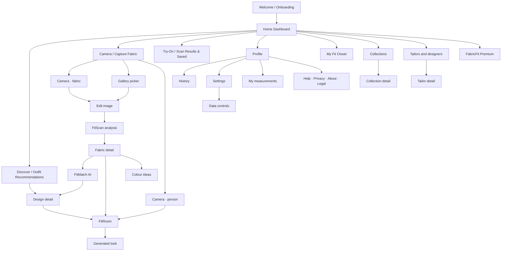

---

## Repository Layout

```
FabricFit/          Android app (Kotlin + Jetpack Compose), package com.fabricfit.app
  app/              app module — Heritage Luxe UI, domain engines, Room DB, on-device ML
  docs/             brand positioning, Play readiness, device QA, research notes,
                    heritage-luxe-mockups/ (UI/UX design reference boards),
                    screenshots/ (real API 33 emulator captures)
  store/            Play listing copy, icon and feature graphic, privacy policy
  tools/            i18n packs (en, tw, gaa, ee), dataset pipeline, mock backend
tools/              sandbox toolchain bootstrap & emulator screenshot capture scripts
```

## Build & Verify

```bash
bash tools/setup_toolchain.sh
cd FabricFit
./gradlew :app:testDebugUnitTest :app:assembleDebug :app:assembleDebugAndroidTest
```

Full build instructions, release signing, and verification notes: [`FabricFit/BUILD.md`](FabricFit/BUILD.md).

## Ghanaian Languages (`i18n`)

FabricFit ships with full string translations in **English**, **Twi (`tw`)**, **Ga (`gaa`)**, and **Ewe (`ee`)**. Translation packs live in `FabricFit/tools/i18n/`; validate and regenerate XML resources with:

```bash
cd FabricFit
python3 tools/i18n/generate.py
```

---

## Taglines

| Context | Line |
| --- | --- |
| **Welcome Hero** | Scan. Discover. Try. Wear. |
| **Heritage Luxe Editorial** | Where Ghanaian Heritage Fabric Meets Modern Style. |
| **Primary Product Line** | Scan Your Fabric. Wear Your Style. |
| **Tech-Focused** | AI-Powered Ghanaian Fabric & Outfit Matching. |

Made with pride in **Accra, Ghana** 🇬🇭
