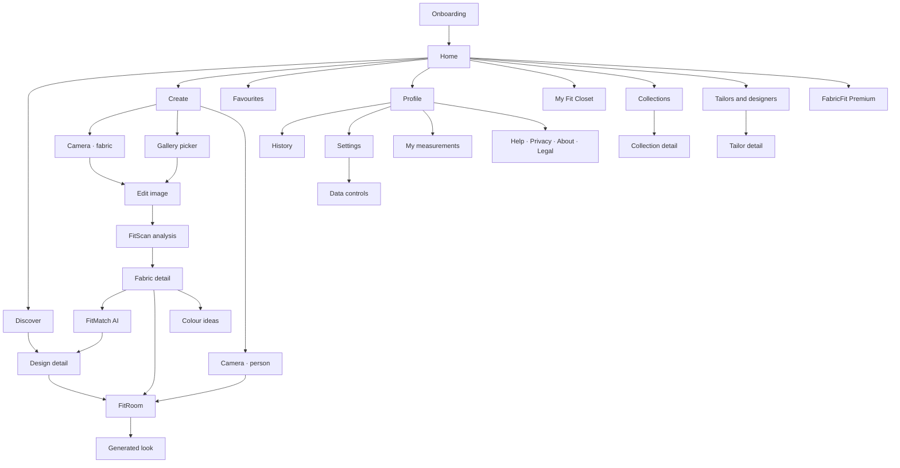

# FabricFit

[](https://github.com/Jacinth-19/fabricfit-app/actions/workflows/build.yml)

**Scan Your Fabric. Wear Your Style.**

FabricFit is an Android app that reads the fabric you already own — kente, ankara, wax
print, lace and more — and shows you what it could become. Photograph a cloth, get
explained outfit matches, preview a look, and carry a shareable brief to your tailor.

> Renamed from **ntoma-studio** / "Ntoma Studio". The GitHub repository is now
> `Jacinth-19/fabricfit-app`; see `FabricFit/docs/brand_positioning.md`.

## Feature names

| Feature | Name |
| --- | --- |
| Camera scanner | **FitScan** |
| AI recommendation engine | **FitMatch AI** |
| Virtual try-on | **FitRoom** |
| Wardrobe & saved items | **My Fit Closet** |

## Repository layout

```
FabricFit/          Android app (Kotlin + Jetpack Compose), package com.fabricfit.app
  app/              app module — UI, domain, data, on-device ML
  docs/             brand positioning, Play readiness, device QA, research notes
  store/            Play listing copy, icon and feature graphic, privacy policy
  tools/            i18n packs, dataset pipeline, mock backend, icon renderer
tools/              sandbox toolchain bootstrap
```

## Build

```bash
bash tools/setup_toolchain.sh
cd FabricFit
./gradlew :app:assembleDebug
```

Full instructions, verified status and release signing: `FabricFit/BUILD.md`.

## Languages

English, Twi (`tw`), Ga (`gaa`) and Ewe (`ee`). Translation packs live in
`FabricFit/tools/i18n/`; regenerate with `python3 tools/i18n/generate.py` from the
`FabricFit` directory.

## Screens

**29 screens**: 28 registered in the navigation graph plus the first-run onboarding gate.
The graph has 29 route registrations because the camera serves two routes (`camera/fabric`
and `camera/person`); routes are declared in
[`ui/navigation/Destinations.kt`](FabricFit/app/src/main/java/com/fabricfit/app/ui/navigation/Destinations.kt)
and wired up in
[`ui/navigation/FabricFitNavHost.kt`](FabricFit/app/src/main/java/com/fabricfit/app/ui/navigation/FabricFitNavHost.kt).
Screen titles below are the strings users actually see.

### Navigation map



### Core tabs (bottom navigation)

| Screen | Route | What it does |
| --- | --- | --- |
| Home | `home` | Greeting, quick "scan fabric" action, recent scans and favourites, and the Tools row |
| Discover | `discover` | Browse every design in the catalogue; smart search filters by your own words |
| Create | `create` | The capture hub — camera, gallery, or preview a design on a person |
| Favourites | `favorites` | Five tabs: Fabrics, Designs, Looks, Collections, Tailors |
| Profile | `profile` | Your stats, history, preferences, measurements, premium and support |

### Scan & analyse — **FitScan**

| Screen | Route | What it does |
| --- | --- | --- |
| Onboarding | *first-run gate, not a route* | Four-step intro (scan, discover, try on, save) shown by `AppShell` while `onboardingCompleted` is false; ends in "Scan my fabric". "Replay onboarding" in Settings re-arms it |
| Camera | `camera/fabric`, `camera/person` | CameraX capture; the person variant is for FitRoom. Permission requested only on tap |
| Edit image | `edit/{uri}/{target}` | Crop and straighten before analysis |
| FitScan analysis | `analysis/{uri}` | The result: palette, pattern, texture, suggested fabric, and which engine ran (on-device or cloud) |
| Fabric detail | `fabric/{id}` | A saved fabric, with its palette, style matches and the jump-off point to matching, try-on and colour ideas |

### Discovery & matching — **FitMatch AI**

| Screen | Route | What it does |
| --- | --- | --- |
| FitMatch AI | `recommendations/{fabricId}` | Ranked designs for this cloth with a match score and a plain-language reason for each; filters by gender and occasion |
| Design detail | `design/{styleId}` | One design in full: the fabrics it suits, the occasions it covers, pick-a-fabric, favourite, share, save to a collection, request a tailor quote, and "try on" |
| Colour ideas | `colormatch/{fabricId}` | Complementary, analogous, neutral and metallic pairings for shoes, bags, jewellery and headwraps |

### Visualisation — **FitRoom**

| Screen | Route | What it does |
| --- | --- | --- |
| FitRoom | `tryon?fabricId={fabricId}&styleId={styleId}&person={person}` | Pick who is wearing it, add a photo, choose the design, then apply the fabric. Shows live progress and the free-try-on quota |
| Generated look | `result/{lookId}` | The finished look with a before/after compare slider, favourite, share, save to gallery, add to a collection, generate variations, or start again with another design or person. Carries both the AI and demo-engine disclaimers |

### Closet, collections & tailoring

| Screen | Route | What it does |
| --- | --- | --- |
| My Fit Closet | `wardrobe` | Photograph clothing, shoes and accessories you own; tabs for Items and Outfits, plus the "Build an outfit" / "Surprise me" builder |
| Collections | `collections` | Group fabrics and designs into your own collections |
| Collection detail | `collection/{id}` | Everything saved into one collection |
| Tailors & designers | `tailors` | Demo directory of tailors and designers |
| Tailor detail | `tailor/{id}?styleId&fabricId` | A tailor's profile plus the shareable design brief ("request a quote") for a specific design and fabric |
| My measurements | `measurements` | Seven fields — height, chest, waist, hip, shoulder, sleeve, inseam — stored only on this device, with a disclaimer that the app never estimates measurements |

### Account, info & legal

| Screen | Route | What it does |
| --- | --- | --- |
| History | `history` | Every scan, chosen design and generated look, with a one-tap clear |
| Settings | `settings` | Analysis provider (on-device vs cloud), cloud URL, notifications, appearance, language, data saver, personalization reset, about |
| Data controls | `settings/data` | Delete my data, and export your contributions as a zip |
| Help & tips | `settings/help` | How it works, FAQs by category, and a support contact that prefills your app version |
| Privacy | `settings/privacy` | The short version first, then what stays on the device, what would be uploaded and why, retention and permissions |
| About | `settings/about` | Logo, tagline, version, "Made in Accra, Ghana" and the credits |
| Legal | `legal/{doc}` | Terms, privacy policy and credits documents |
| FabricFit Premium | `premium` | Free-tier limits explained, premium benefits, and the paywall sheet. This build ships a demo billing manager, labelled as such |

### Real app UI

These are **unretouched screenshots of the running FabricFit Android app**, captured by
GitHub Actions on an API 33 Pixel 2 emulator at 1080 × 1920. They are real app screens,
not mockups; first-run coach marks were dismissed, while the empty Favorites and Fit
Closet states are the app's genuine fresh-install experience.

<table>
  <tr>
    <td align="center"><br><strong>Home</strong></td>
    <td align="center"><br><strong>Discover</strong></td>
    <td align="center"><br><strong>Create</strong></td>
  </tr>
  <tr>
    <td align="center"><br><strong>Favourites</strong></td>
    <td align="center"><br><strong>Profile</strong></td>
    <td align="center"><br><strong>My Fit Closet</strong></td>
  </tr>
</table>

To refresh the captures, run the manual `build.yml` workflow. Its `screenshots` job
rebuilds the debug app, drives the emulator with
[`tools/qa/capture_fabricfit_screens.sh`](tools/qa/capture_fabricfit_screens.sh), and
uploads the PNGs as `fabricfit-readme-screens`.

These README preview captures are **not** Play Store listing creatives. Play requires at
least two phone screenshots (16:9 or 9:16, 320–3840 px); the feature-focused shot list in
[`docs/PLAY_DATA_SAFETY.md`](FabricFit/docs/PLAY_DATA_SAFETY.md) remains
**Home** → **FitScan analysis** → **FitMatch AI** → **FitRoom** → **My Fit Closet** and
should be saved separately under `FabricFit/store/screenshots/`.
